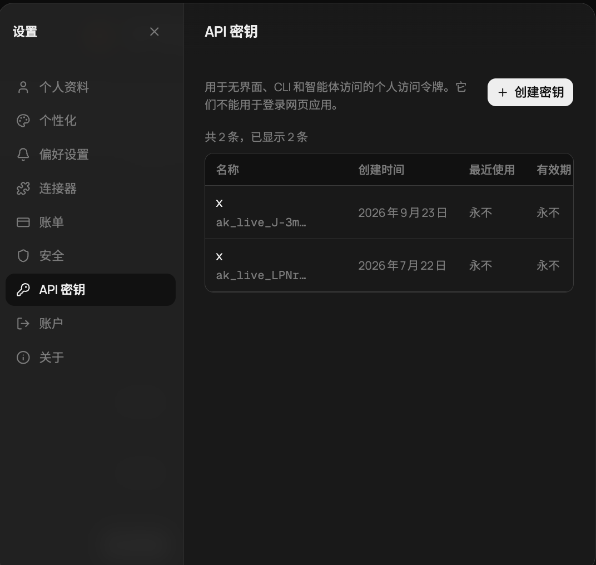
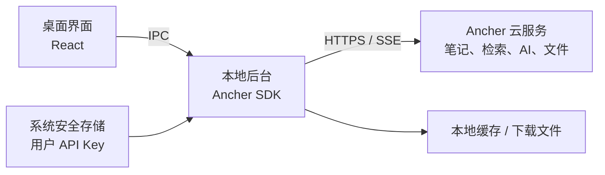
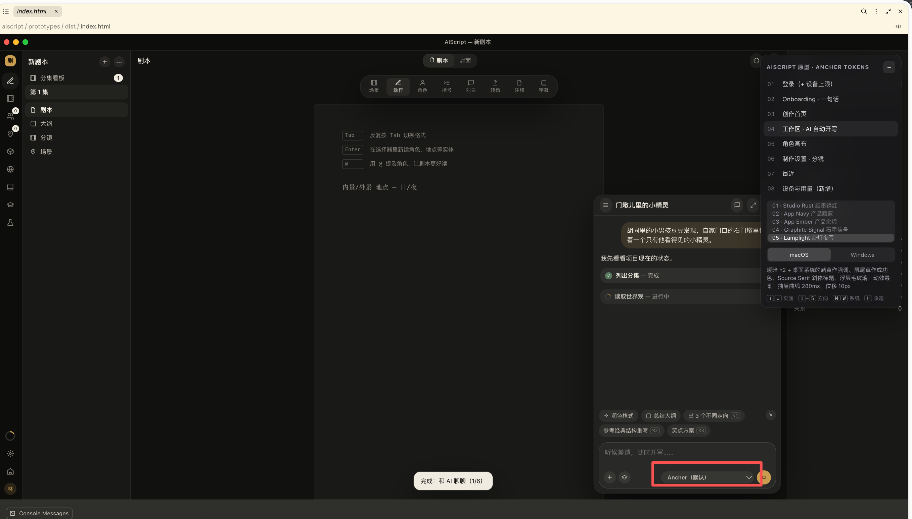

# 桌面应用与 Ancher SDK 讨论记录

导出日期：2026-10-08

本文按顺序记录本窗口中的用户提问和助手正式回答。图片随文档保存于 assets 目录，并使用相对路径引用；工具调用、工具返回和工作过程提示未纳入正文。文中技术判断与接口信息保留对话当时的表述。

---

## 1. 查找 LLM Space

### 用户

帮我查一下 llm space github 上的 链接

### 助手

找到了：[LLM Space GitHub 仓库](https://github.com/deer-flow/llm-space)。

这是 DeerFlow 的姊妹项目，用于开发、调试和评估 AI Agent 的桌面应用。

[下载页面](https://github.com/deer-flow/llm-space/releases) · [中文介绍](https://github.com/deer-flow/llm-space/blob/main/README.zh-CN.md)

## 2. LLM Space 的打包方式

### 用户

帮我看一下这个桌面应用 是怎么打包的

### 助手

看了当前仓库代码，**它使用 Electrobun 打包，技术组合是 React + Vite + Bun + Electrobun**。[依赖与构建命令](https://github.com/deer-flow/llm-space/blob/main/apps/desktop/package.json)

可以把它理解成：**React 写界面，Bun 运行本地逻辑，Electrobun 提供桌面窗口并生成安装包。**

具体流程是：

```text
React / TypeScript 界面
        ↓ Vite build
HTML、JS、CSS → dist/
        ↓ Electrobun build
加入 Bun 后端、静态资源、图标、桌面启动器
        ↓ macOS 签名、公证
.app → .dmg 安装包
        ↓ GitHub Actions
发布到 GitHub Releases
```

Vite 构建的页面会被复制到应用内部，正式运行时窗口加载 `views://mainview/index.html`；界面通过 Electrobun RPC 调用 Bun 后端。[打包配置](https://github.com/deer-flow/llm-space/blob/main/apps/desktop/electrobun.config.ts) · [窗口代码](https://github.com/deer-flow/llm-space/blob/main/apps/desktop/src/bun/app/window.ts)

**它还打包了两个版本：**

| 版本 | 界面渲染方式 | 特点 |
|---|---|---|
| 普通版 | 系统 WebView | 安装包较小 |
| Performance 版 | 内置 Chromium / CEF | 自带浏览器引擎，包更大 |

两者使用不同的应用标识和更新地址，可以同时安装，共享 `~/.llm-space` 数据目录。通过 `LLM_SPACE_DESKTOP_RENDERER=cef` 切换构建版本。[配置来源](https://github.com/deer-flow/llm-space/blob/main/apps/desktop/electrobun.config.ts)

**本地打包已有现成命令**，在仓库根目录执行：

```bash
mise run setup      # 安装工具和依赖
mise run pack       # 普通版，不签名
mise run pack:perf  # CEF 版，不签名
```

这些命令最终执行 `vite build` 和 `electrobun build --env=canary`。[命令定义](https://github.com/deer-flow/llm-space/blob/main/mise.toml)

正式发布由推送 `v*` 标签触发：GitHub Actions 分别构建 **Apple Silicon / Intel × 普通版 / Performance 版**，完成 Apple Developer ID 签名、公证和启动检查，再上传 DMG。自动更新另外发布 `.tar.zst`、差量 `.patch` 和 `update.json`。[发布流水线](https://github.com/deer-flow/llm-space/blob/main/.github/workflows/release.yml)

目前这条桌面发布流水线只生成 **macOS 安装包**；配置虽然有 Windows、Linux 字段，但没有对应的桌面发布任务。

## 3. LLM Space 的服务器与后端

### 用户

所以它有 服务器和后端吗

### 助手

**有后端，也有独立的服务器程序，但普通桌面使用不需要另外部署服务器。**

它支持两种运行方式：

| 模式 | 后端在哪里运行 | 桌面应用负责什么 |
|---|---|---|
| 本地模式 | 电脑上的 Bun 进程，随桌面应用一起打包 | 界面、Agent 执行、本地文件和配置管理 |
| 远程模式 | Linux 服务器上的 `llm-space-server` | 展示界面，通过 SSH 隧道连接远端 |

本地模式可以理解为：

```text
桌面界面（React） → RPC → 本地后端（Bun） → 模型 API / 工具 / 文件
```

所以它虽然是桌面应用，内部仍然有前后端分工。[本地通信代码](https://github.com/deer-flow/llm-space/blob/main/apps/desktop/src/lib/electrobun.ts)

如果选择远程模式，Agent、MCP、工具、工作区和模型配置会由远端服务器负责执行和管理。桌面应用能通过 SSH 准备、启动远端 runtime 并建立隧道。[远程运行文档](https://github.com/deer-flow/llm-space/blob/main/docs/remote-runtime.zh-CN.md)

**你只在自己电脑上用的话，下载安装桌面版、配置模型即可；想让 Agent 在服务器上跑，再使用远程模式。**

## 4. Flowix 的打包、模型接入与服务器

### 用户

[https://flowix-memo.com](https://flowix-memo.com) 再帮我看一下这个，是怎么打包的，怎么内嵌各种模型/sdk，远程还是本地，是否有服务器 etc

### 助手

**Flowix 是“本地桌面应用 + 本地 Agent 运行时 + 可选云服务”的架构。模型通常通过远程 API 调用，也支持连接本地 Ollama。**

我查了[官网](https://flowix-memo.com/)和[公开源码](https://github.com/text2future/flowix)。下面依据当前 `main` 分支；它的架构已有变化，早期版本的“内置 DSH 单文件”介绍不能完全代表现在的实现。

### 1. 桌面应用怎么打包？

技术组合是 **Tauri 2 + Rust 后端 + React / TypeScript / Vite 前端**。

```text
React 界面 → Vite 构建静态资源
Rust 后端 → Cargo 编译原生程序
              ↓
Tauri 打包：界面 + 原生程序 + CLI / Agent 资源
              ↓
macOS：DMG    Windows：NSIS EXE
```

macOS 使用系统 WKWebView，Windows 使用 WebView2。构建脚本还支持 Linux AppImage，但官网目前主要宣传 macOS、Windows。

正式包有签名和更新机制：macOS 配置 Developer ID 签名与公证，更新包另有签名验证，通过下载站的 `latest.json` 获取更新。[Tauri 配置](https://github.com/text2future/flowix/blob/main/app/flowix-desktop/tauri.conf.json) · [生产构建脚本](https://github.com/text2future/flowix/blob/main/scripts/build-tauri-production.mjs)

### 2. “内嵌各种模型 / SDK”实际怎么做？

**打包进去的是 Agent 程序、模型接入代码和模型目录；没有看到将大模型权重装进安装包的实现。**

当前主要有三种接入方式：

| 接入方式 | 怎样交付 | 在哪里执行 |
|---|---|---|
| **Pi Agent** | 当前生产构建默认随应用附带 | 本机子进程 |
| **DeepSeek Harness（DSH）** | 独立下载、安装、更新运行时 | 本机子进程 |
| **Codex、Claude Code、OpenCode 等** | 连接本机已有的 CLI | 本机外部进程 |

具体来说：

- **Pi**：构建时下载对应系统、架构的 Pi 发布包，校验 SHA-256，再放进 Tauri 的资源目录。Rust 后端启动 `pi --mode rpc`，通过标准输入输出通信。[打包脚本](https://github.com/text2future/flowix/blob/main/scripts/prepare-pi-bundle.mjs) · [启动代码](https://github.com/text2future/flowix/blob/main/app/flowix-desktop/src/agent_external/pi/runtime.rs)
- **DSH**：当前与桌面应用分开分发。运行时包包含私有 Node、DSH 代码、依赖及 Flowix 插件，下载验证后安装到本地，再作为子进程启动。[安装管理代码](https://github.com/text2future/flowix/blob/main/app/flowix-desktop/src/dsh.rs) · [运行时构建](https://github.com/text2future/flowix/blob/main/scripts/build-dsh-prod.mjs)
- **外部 CLI**：例如 Codex、Claude Code，源码会查找本机可执行程序路径，再调用它们。[Codex 查找代码](https://github.com/text2future/flowix/blob/main/app/flowix-desktop/src/agent_external/codex/binary.rs) · [Claude 查找代码](https://github.com/text2future/flowix/blob/main/app/flowix-desktop/src/agent_external/claude/binary.rs)

多模型支持通过 provider 适配实现。Pi 的模型目录来自 `@earendil-works/pi-ai`；DSH 接入配置则区分 OpenAI Responses、OpenAI Completions、Anthropic Messages 等协议，并设置模型名、API 地址和凭证。[模型目录生成](https://github.com/text2future/flowix/blob/main/scripts/prepare-pi-catalog.mjs) · [Provider 配置](https://github.com/text2future/flowix/blob/main/app/flowix-desktop/src/agent_external/deepseek_harness/config.rs)

### 3. AI 到底是远程还是本地？

要分开看 **Agent 执行**和**模型推理**：

```text
本机：
React 界面 → Rust 后端 → Pi / DSH / 外部 CLI
                              ↓
模型推理：
远程模型 API，或本机 Ollama
```

Agent 的会话管理、工具调用、读写文件等在本机执行。选择 DeepSeek、OpenAI、Anthropic 等配置时，请求发送到对应 API 服务；选择 Ollama 时，代码默认指向 `http://127.0.0.1:11434/v1`，模型推理可以在本机完成。

因此，**“本地优先”主要指笔记存储和应用运行位置；使用云模型时，提供给模型的上下文仍会发送到配置的服务地址。**[Provider 路由源码](https://github.com/text2future/flowix/blob/main/app/flowix-desktop/src/agent_external/deepseek_harness/config.rs)

### 4. 有没有服务器？

有三类，需要区分：

| 服务 | 用途 | 普通本地使用是否依赖 |
|---|---|---|
| **模型服务** | 执行模型推理 | 云模型需要联网；Ollama 可本地运行 |
| **Flowix Cloud** | 账号、笔记同步、附件、会员权益 | 本地笔记使用不要求账号 |
| **下载 / 更新服务** | 分发应用和 DSH 运行时 | 安装、更新时使用 |

源码中有 Flowix Cloud 客户端，默认 API 地址为 `https://cloud.flowix.cc`，包含登录、同步、附件上传和权益查询接口。**这证明项目有云服务接入，但我没有在当前公开仓库里找到对应云端服务的完整实现，无法确认其实际部署框架、数据库或云厂商。**[云服务地址](https://github.com/text2future/flowix/blob/main/app/flowix-sync/src/lib.rs) · [云 API 客户端](https://github.com/text2future/flowix/blob/main/app/flowix-sync/src/client.rs)

另外，仓库里的 **`dsh-appserver` 不代表必须部署一台远程服务器**：桌面端默认把它作为本地子进程，通过 stdio JSON-RPC 通信。它也实现了 HTTP / SSE 接口，但这属于运行时能力，不能据此认定官网把用户的 Agent 放在云端执行。[App Server 文档](https://github.com/text2future/flowix/blob/main/dsh-appserver/README.md)

如果你想借鉴它来开发产品，核心做法就是：**用 Tauri 打包 UI 和 Rust 后端，把 Agent 作为本地子进程集成，通过 RPC 通信；模型走可配置 API，云同步作为独立服务。**

## 5. 用 Ancher SDK 做无需自建服务器的桌面壳

### 用户

ok 我现在想做一个 本地桌面端的壳，调用 ancher sdk（[https://www.npmjs.com/package/@ancher-ai/sdk](https://www.npmjs.com/package/@ancher-ai/sdk)），给用户 api，实现 ancher.ai 的一切能力，不想要服务器，怎么办，应该借鉴什么



### 助手

**可以做，而且不需要你自建服务器。建议做成“用户填写自己的 Ancher API Key，桌面端直接调用 Ancher 云服务”的客户端。**

但有一个关键区别：**桌面壳在本地，Ancher 的核心能力仍在云端。**我查了 SDK，它是 Ancher API 的 TypeScript 客户端，默认请求 `https://api.ancher.ai`，并没有把 Ancher 后端或模型运行时包含进去。[SDK 文档](https://github.com/streamify-one/ancher-sdk-typescript#quick-start)

我先按“每位用户填写自己的 Key”理解你的“给用户 API”。截图里的个人访问令牌正好对应这种接入方式。

### 推荐架构



**本地后台只是应用里的一个进程，不需要部署服务器，也不需要启动 localhost HTTP 服务。**界面通过 IPC 请求本地后台，后台运行 SDK，再把结果和流式事件送回界面。

你负责桌面交互、凭证保存、文件选择、缓存和通知；Ancher 负责 API 已经开放的业务能力。

### 桌面框架应该选什么？

**如果现在要开始做，我建议第一版用 Electron + React + TypeScript。**

原因很直接：Ancher SDK 本身是 TypeScript，Electron 的主进程自带 Node.js 环境，可以直接运行 SDK；不需要额外把 JS 运行时打成 sidecar，也不需要把 SDK 改写成 Rust。[Electron 进程模型](https://www.electronjs.org/docs/latest/tutorial/process-model)

| 方案 | 对你这个项目的适配 |
|---|---|
| **Electron** | 首选：SDK 在主进程运行，UI 通过 IPC 调用 |
| **Electrobun** | 想控制包体积时考虑：参考 LLM Space，在 Bun 后台运行 SDK，先验证兼容性 |
| **Tauri** | 能做，但为了运行 TS SDK，通常还要处理 JS sidecar 或原生网络桥接，集成步骤更多 |

Electrobun 提供 Bun 与桌面 UI 的组合；Tauri 支持打包外部可执行程序。[Electrobun 官网](https://blackboard.sh/electrobun/) · [Tauri Sidecar 文档](https://v2.tauri.app/develop/sidecar/)

**在你之前看的两个项目里，主要借鉴 LLM Space 的“界面 ↔ 本地后台”分工。**Flowix 的多 CLI、DSH 独立运行时和云同步系统，对目前这个 SDK 客户端来说没有必要全部引入。

### SDK 放在哪？怎样用用户的 Key？

建议把 SDK 放在 **Electron 主进程**：

```ts
// 在本地主进程运行
import { createAncherSdk } from '@ancher-ai/sdk'

const sdk = createAncherSdk({
  apiKey: userApiKey,
  credentials: 'omit',
})

const user = await sdk.User.me()
const notes = await sdk.Note.list({ limit: 20 })
```

推荐的用户流程：

1. 用户在 Ancher 官网创建个人 API Key。
2. 在桌面应用粘贴 Key，调用 `User.me()` 验证。
3. 验证成功后，用系统安全存储保存 Key。
4. 界面只调用你定义的业务接口，例如“列出笔记”“发送消息”“上传文件”。
5. 主进程负责 SDK 调用、取消请求和流式事件转发。

这是建议的实现方式；**目前我没有用真实 Key 验证接口权限。**不要在安装包里放一把你自己的共享 Key。每位用户使用自己的凭证，权限和额度由 Ancher 服务决定。

### 能做到 Ancher 的“一切能力”吗？

**可以覆盖大量公开 API 能力，但现在不能承诺与官网完全一致。**

SDK 已提供笔记、文件、集合、标签、对话、产物、检索和部分账户操作；聊天支持 SSE，能接收文字、工具活动、引用等结构化事件。你要实现的是这些事件对应的桌面 UI。[SDK 功能与流式接口](https://github.com/streamify-one/ancher-sdk-typescript#entity-repositories)

这里还有三个边界：

- **API 有方法，不等于个人 Key 有权调用。**需要逐项验证权限。
- **注册、网页登录、第三方连接授权等涉及交互流程。**SDK 的便捷接口不能替你完成整个网页流程。
- **SDK 调用成功，不代表数据只存在本地。**例如文件上传会进入远程存储；本地缓存也不能让云端 AI 离线运行。[认证与上传说明](https://github.com/streamify-one/ancher-sdk-typescript#file-upload)

因此第一步应该做一张 **“官网功能 → SDK 方法 → Key 权限 → 桌面交互”** 对照表，再决定功能范围。

我的具体建议是：**先做 Electron 桌面客户端，打通 Key 验证、笔记列表、文件上传、流式聊天四条链路。验证通过后，再扩展 Ancher 的其他接口。**这样你无需维护自己的业务服务器，也不用重新实现模型接入和 Agent 引擎。

## 6. Ancher 检索与视频解析

### 用户

比如 检索 和解析 视频 可以吗

### 助手

**检索可以；视频解析也有接入入口，但具体支持哪些视频平台、文件格式，需要用真实 Key 验证。你无需自建服务器，处理交给 Ancher 云端。**

| 能力 | 桌面端怎么接 |
|---|---|
| 搜索已保存的知识 | `sdk.Retrieval.notes(query)` |
| 检索相关内容片段，用于 RAG | `sdk.Retrieval.chunks(query)` |
| 导入视频链接 | `sdk.Note.createFromUrl({ text: videoUrl })` |
| 导入本地视频文件 | 先 `sdk.File.upload(file)`，再 `sdk.Note.createFromFile({ file_id: file.id })` |

检索接口针对 **Ancher 里已保存的知识**，不能直接理解成全网搜索。[SDK 接口说明](https://github.com/streamify-one/ancher-sdk-typescript#entity-repositories)

视频方面，官网明确介绍了 YouTube 等来源的视频采集，以及自动提取要点、总结和视频关键帧。SDK 提供通用的链接、文件导入入口，但这还不足以证明任意视频都能成功解析。[官网功能介绍](https://ancher.ai/#features)

你的桌面应用可以实现这样的流程：

```text
用户粘贴视频链接 / 选择视频文件
        ↓
SDK 提交给 Ancher
        ↓
云端抓取、解析，生成结构化笔记
        ↓
桌面端查询处理状态，展示结果
        ↓
用户检索内容，或向 AI 提问
```

**因此不需要在安装包里嵌入视频解析模型。**如果你要求视频完全在本地解析、文件不上传，那就需要额外集成本地转录、关键帧提取和模型；Ancher SDK 本身不提供这套本地执行能力。

第一轮验证建议选：**一个公开视频链接、一个本地 MP4、一次对解析结果的检索**。这样就能确认 API Key 权限、视频支持范围，以及返回内容是否满足你的界面需求。

## 7. 剧本壳、Loro、Mastra 与本地运行

### 用户

还有就是 我把它改成了一个剧本的壳，ancher 的 sdk 放在了这里，构建特别鸣谢 Loro CRDT/Mastra，这样也可以本地？不用服务器？



### 助手

**可以。剧本编辑器 + Loro + Mastra + Ancher SDK，完全可以打包成桌面应用，不用你自建服务器。**不过，Ancher 的检索、视频解析和 AI 仍然通过网络调用 Ancher 云端。

截图展示的是界面原型；仅凭界面和“特别鸣谢”还不能判断当前代码是否已经这样运行。

各部分可以这样分工：

| 部分 | 放在哪里 | 负责什么 |
|---|---|---|
| 剧本界面 | 本机 | 剧本、角色、大纲、分镜的编辑与展示 |
| **Loro CRDT** | 本机 | 文档状态、修改历史、合并编辑 |
| **Mastra** | 本地后台进程 | 编排“读取剧本 → 检索素材 → 生成建议 → 修改剧本”等流程 |
| **Ancher SDK** | 本地后台进程 | 请求 Ancher 云端接口 |
| 项目与历史数据 | 本地文件 / SQLite | 保存剧本、附件、会话和流程状态 |

Loro 可以把文档快照和增量保存到本地；它本身不要求服务器。跨设备或多人协作时，才需要额外实现数据传输、持久化和权限管理。[Loro 持久化文档](https://loro.dev/docs/tutorial/persistence)

Mastra 也可以作为库在本地 Node.js 进程中直接调用，不必部署 Mastra HTTP 服务；会话存储可以使用本地 SQLite。[直接调用示例](https://mastra.ai/docs) · [本地存储说明](https://mastra.ai/blog/agent-memory-layers)

建议你的桌面架构是：

```text
剧本界面 + Loro
      ↕ IPC
本地后台：Mastra + Ancher SDK
      ├─ 读写本地剧本、SQLite、附件
      └─ HTTPS → Ancher 云端
```

**有一个很重要的设计点：截图里的“Ancher（默认）”要明确代表哪一种能力。**

- **直接使用 Ancher 对话**：SDK 发消息、接收流式回答，你的应用展示结果。可以先不使用 Mastra。
- **由 Mastra 控制剧本创作流程**：Mastra 在本地执行流程，把 Ancher 的检索、解析等接口包装成工具；生成步骤使用明确支持的模型接入方式。

**Ancher SDK 不能未经适配就当成 Mastra 的模型 provider。**它提供的是业务 API 和对话接口；也没有证据表明云端 Ancher Agent 能直接操作你本机的剧本文件。修改本地剧本，需要由你的本地后台执行。[Ancher SDK 文档](https://github.com/streamify-one/ancher-sdk-typescript)

例如“参考视频，改写第 3 场”可以做成：

```text
Ancher 云端解析视频、检索素材
      ↓
本地流程结合第 3 场内容生成修改建议
      ↓
界面展示修改预览
      ↓
用户接受 → 写入 Loro → 保存本地项目
```

**我建议继续用 Electron：Loro 管剧本文档，主进程或独立本地工作进程运行 Mastra 和 Ancher SDK。**第一版先实现单机保存、Ancher 素材检索和修改预览。这样编辑剧本可以离线，调用 Ancher 时联网，无需维护自己的业务服务器。

## 8. Mastra 是什么

### 用户

Mastra 是啥

### 助手

**Mastra 是一个用 TypeScript 编写的 AI Agent 和工作流开发框架。**它负责组织模型、工具和执行步骤，本身不是大模型。[官方文档](https://mastra.ai/docs)

放到你的剧本应用里，可以这样理解：

- **模型**：负责理解、写作，例如生成对白。
- **Ancher SDK**：负责调用 Ancher 的检索、视频解析、对话等服务。
- **Mastra**：负责把这些能力串成流程。
- **Loro**：负责管理剧本文档的编辑状态和合并。

比如用户说：“参考这个视频，改写第三场。”你可以用 Mastra 编排：

```text
读取第三场 → 调用 Ancher 获取视频素材
          → 调用模型生成改写
          → 展示修改预览
          → 用户接受后保存
```

它还提供工具调用、会话记忆、流程状态和执行追踪等能力，可以在桌面应用的本地后台运行。

**你现在不一定需要它。**如果只是“聊天窗口调用 Ancher，然后把结果插入剧本”，直接使用 Ancher SDK 就够了。等你需要多步骤创作流程、多个 Agent 或复杂工具调用时，再引入 Mastra。

## 9. 是否需要下拉菜单

### 用户

所以我这里还需要放一个 下拉菜单吗


### 助手

**如果第一版只接 Ancher，这里不需要下拉菜单。**可以把“Ancher（默认）⌄”改成固定的“Ancher”，API Key 放到设置里管理。

以后根据用户实际能切换的内容，再增加菜单：

| 用户切换什么 | 菜单示例 |
|---|---|
| AI 服务 / Agent | Ancher、Claude Code、Codex |
| 模型 | 只展示对应接口支持选择的模型 |
| 创作模式 | 剧本创作、素材研究、对白润色 |

**Mastra 和 Loro 不要放进这个菜单**，它们是应用内部使用的技术，不是用户选择的 AI 服务。

按你现在的剧本产品，我建议：**底部显示固定的 Ancher 标识，把“润色对白、续写场景、检查人物一致性”等创作操作放在输入框上方。**等真的接入第二个服务，再把标识变成下拉选择器。

## 10. Gemini、本地视频与逐字稿

### 用户

我还想加入 gemini 的模型，比如把本地的视频路径给 agent 对话窗口，让它转成逐字稿，我是否可以自己选择模型，比如 gemini，这样也可以本地？不用服务器？

### 助手

**可以自己选 Gemini，也可以不自建服务器。**但准确地说是：**桌面应用和文件读取在本地，Gemini 推理在 Google 云端。**

你说的“把本地视频路径给对话窗口”，需要由应用完成这一步转换：

```text
用户拖入视频 / 提供本地路径
        ↓
桌面后台读取视频文件
        ↓
上传到 Gemini Files API，等待处理完成
        ↓
调用所选 Gemini 模型生成逐字稿
        ↓
结果展示在对话里，保存到本地项目
```

**仅把 `/Users/xxx/video.mp4` 这串路径发给模型没有用**，云端访问不到你的电脑。应用必须读取并上传文件内容。Gemini 官方支持视频文件输入，以及对视频音频、画面和时间点的分析。[视频理解文档](https://ai.google.dev/gemini-api/docs/video-understanding)

对于“逐字稿”，建议区分两种任务：

- **只要对白转录**：可以先在本地提取音轨，再调用转录接口，避免上传不需要的画面。
- **还要镜头、动作、人物描述**：上传视频，要求输出带时间戳的对白与画面描述。

Google 也提供专门的音频转录接口；最终仍应检查漏字、人名和时间戳准确性。[音频转录文档](https://ai.google.dev/gemini-api/docs/transcribe?hl=en)

现在你的下拉菜单就有实际用途了：

| 选择 | 后台调用 |
|---|---|
| **Ancher** | Ancher SDK，使用用户的 Ancher Key |
| **Gemini · 具体模型** | Google GenAI SDK，使用用户的 Gemini Key |

**Ancher Key 不能直接用于调用 Gemini。**设置里需要分别配置两种凭证，菜单只显示已接入、且支持当前任务的选项。[Gemini API 认证说明](https://ai.google.dev/gemini-api/docs/api-key)

这个流程第一版直接用两个 SDK 就能实现，Mastra 是可选的。**如果你要求视频不上传、断网也能转录，那要接入本地语音识别模型，不能靠云端 Gemini API。**

## 11. 是否需要工作流

### 用户

但是不是需要一个工作流？

### 助手

**对，需要一个工作流。但工作流可以在桌面应用里执行，不需要部署服务器，也不一定要用 Mastra。**

你这个“本地视频 → 逐字稿”的流程是：

```text
选择视频
  → 检查格式、大小
  → 上传视频，或本地提取音轨后上传
  → 等待云端处理完成
  → 调用 Gemini 转录
  → 接收结果
  → 保存到本地项目
```

桌面后台负责推进每一步，界面显示“上传中、解析中、转录中、已完成”，并支持取消、失败重试。

**固定流程，用普通 TypeScript 就能实现。**如果之后扩展为：

```text
转录 → 分析人物 → 划分场景 → 生成分镜
                  → 用户确认 → 写入剧本
```

而且需要分支、暂停、恢复、多个 Agent 配合，Mastra 就更有价值。

对你现在的产品，我建议：**先把视频转录做成一个本地执行、能保存任务状态的固定工作流。**用户在聊天窗口发起任务、选择 Gemini，后台执行流程；聊天窗口负责展示进度和结果。

## 12. 导出对话

### 用户

帮我把这个窗口下的对话全部输出 为。md

