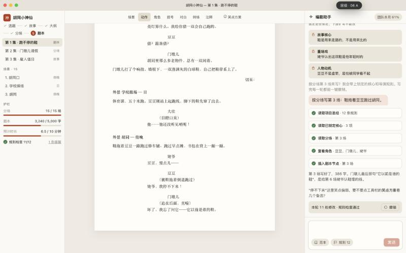
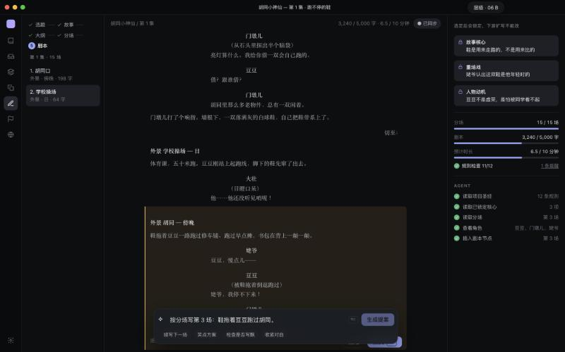

# AIScript 原型

直接双击 `dist/index.html` 即可，离线可用。一个文件，20 层（10 页 × 2 个方向）。

- 右上角是层级切换器：`↑/↓` 换页，`A/B` 换方向，`M/W` 切换 macOS / Windows 外框，`H` 收起
- 每一页都有可以点的交互，比如 P6 的「发送」/「生成提案」、P1 的「演示：在第 4 台电脑上登录」
- 页面清单、对应的客户痛点和两个方向的取舍见 [specs/0002 §9](../specs/0002-desktop-client-spec.md)

| A · Studio Paper | B · Night Desk |
|---|---|
|  |  |

修改源码（`src/`）后重新构建并校验：

```bash
node prototypes/build.mjs && node prototypes/check.mjs
```

示例项目《胡同小神仙》是为原型虚构的内容，不包含客户或第三方的 IP。
