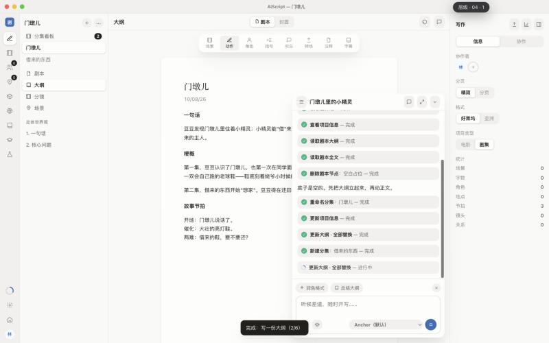
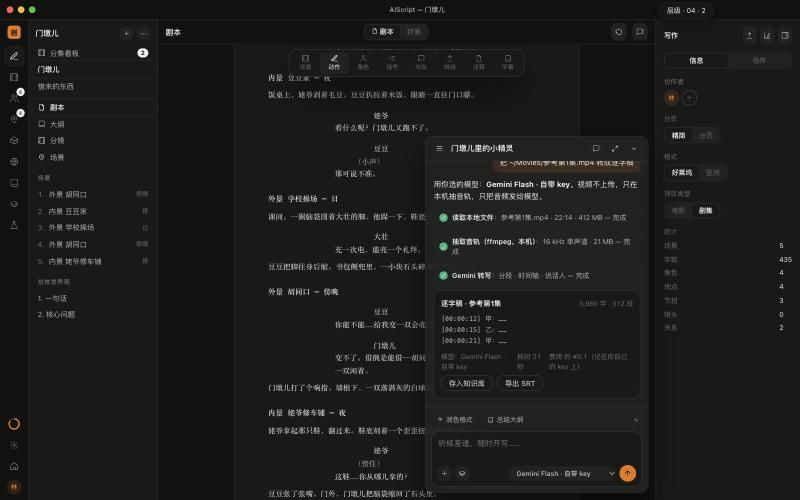

# AIScript 原型 v2

`dist/index.html` 是单个文件，共 40 层：**8 个页面 × 5 个 design token 方向**，每层都是一份完整的 HTML 文档。文件大约 1.2MB，有些预览器打不开，用浏览器直接打开即可，离线可用。

- **交互**：一比一按 laper.ai 的实际流程（见 [走查记录](../docs/research/laper-walkthrough.md)）。工作区一打开，AI 就自动根据那句故事开写：读取 → 改名 → 写大纲（自动切到大纲视图）→ 建角色和地点 → 逐个插入剧本节点（正在写的高亮）。新手任务 toast 联动，每轮结尾 AI 提一个问题，第二轮显示"N 处修改 · 撤销"
- **视觉**：只取 ancher-website 的 design token（`src/styles/tokens`：n2 中性色、b1–b5 品牌色、Manrope / Instrument Serif / Geist Mono、10px 圆角锚点 × 倍率、阴影阶梯）。5 个方向的 DOM 完全相同，只换 token 映射，由 `check.mjs` 机检保证

| # | 方向 | token 映射 |
|---|---|---|
| 01 | Ink Navy · 纸墨藏蓝 | ancher 浅色默认：n2 浅色 + b1，衬线标题，圆角 ×1 |
| 02 | Ember Night · 余烬橙夜 | ancher 深色默认：n2 深色 + b2，衬线标题，阴影加深 |
| 03 | Signal · 信号蓝 | b3 + 纯白，圆角 ×0.5，无衬线粗体，字号 0.95，等宽 eyebrow |
| 04 | Garden · 苗圃绿 | b4 + 暖白，圆角 ×1.5，字号 1.05，大阴影 |
| 05 | Dusk Glass · 暮紫 | b5 + 深色，圆角 ×1.2，衬线斜体，浮层毛玻璃 |

快捷键：`↑/↓` 换页，`1–5` 换方向，`M/W` 切换 macOS / Windows 外框，`H` 收起切换器。

P4 工作区里还有三项我们新增的对话能力：
- 输入框里的**模型选择**：Ancher / Gemini（用自己的 key）/ 本地 SenseVoice
- **把本地视频转成逐字稿**（建议 chip）
- **参考哆啦A梦第 1 集的结构重写**（建议 chip，只取骨架）

| 01 · 自动开写（大纲阶段） | 02 · 第二轮后 + 本地视频转写 |
|---|---|
|  |  |

构建并校验：

```bash
node prototypes/build.mjs && node prototypes/check.mjs
```

v1（10 页 × 2 个方向，按客户痛点设计的独立页面）存档在 [`v1/`](v1/)。示例故事是原创内容。
