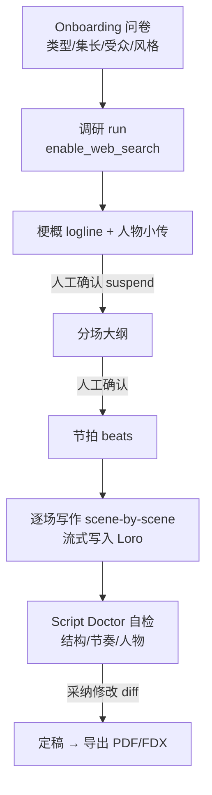
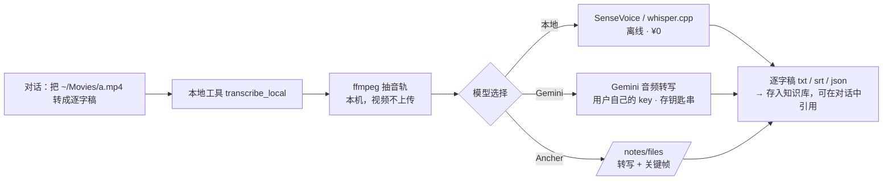
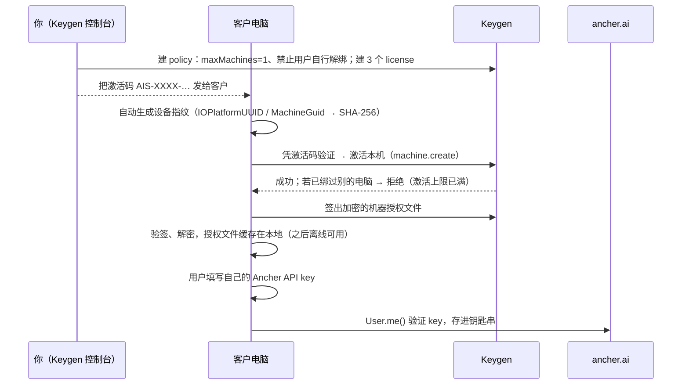
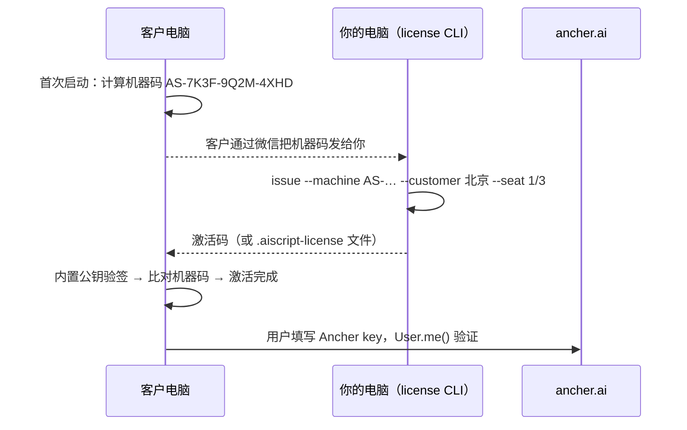

# 0002 · AIScript 桌面客户端（Windows + macOS）规格与上线路线图

> 状态：草案 **v0.2** · 2026-10-08（v0.2：改为纯本地、无服务器、激活码，见 §0） · 作者：Claude Code（基于 [0001](./0001-aiscript-spec.md) 的原始需求）
> 读法：§1–§3 是结论与决策；§4–§9 是设计；§10 是"对照陈天 SDD 还差什么"；§11–§13 是测试、上线与待决项。
> 证据等级：**[实证]** 亲自核验（页面 / 源码 / 包内文件）；**[推断]** 有线索但未直接证实；**[待验证]** 需要账号、对方确认或实测。

---

## 0. v0.2 方向调整（2026-10-08）：纯本地、无服务器、激活码

依据：你和大模型的讨论记录 [`docs/chat-exports/桌面应用与-Ancher-SDK-讨论记录-2026-10-08.md`](../docs/chat-exports/桌面应用与-Ancher-SDK-讨论记录-2026-10-08.md)，以及 2026-10-08 的补充要求。

| 项 | v0.1（作废） | **v0.2（现行）** |
|---|---|---|
| 服务器 | 自建网关、账本、同步、运营后台 | **没有任何业务服务器**。应用就是"Electron 壳 + 本地后台进程"，直接调用 Ancher 和 Gemini 的云端 API |
| 登录 | 账号登录 + 设备绑定 | **不登录**。安装后输入**激活码**（只负责授权）；激活后**用户自己填写 Ancher API key**（在 ancher.ai → 设置 → API 密钥 里创建） |
| 3 台电脑 | 服务端记录设备 | **每台电脑一个激活码**，激活码绑定机器码，换一台电脑就失效（§6） |
| 用量 | 服务端账本 | **不显示用量**（2026-10-08 决定）。各自的 Ancher 积分在 ancher.ai 账户里看 |
| 模型 | 统一走网关 | Ancher（用户填写的 key，必填）+ 可选 Gemini（用户填写的 key），菜单**只列出已配置的服务** |
| 编排 | Mastra | **先用普通 TypeScript 写固定工作流**（状态持久化、可取消、可重试）；出现分支、暂停、多 Agent 时再引入 Mastra |
| AI 改稿 | — | **新写的内容直接写入、按轮撤销（同 laper）**；**改写已有内容先出修改预览，接受后才写入 Loro** |

**"激活码只能用一次"能否实现？**
- 纯离线、预先生成、谁拿到都能输入的码：**做不到**。没有共享记录，第二台电脑无法知道这个码已经被用过。
- **推荐（现行）：Keygen 托管激活。** 你预先发 3 个激活码；用户只输入激活码，应用自动生成设备标识，首次联网时由 Keygen 记录"这个码已绑定这台电脑"，之后离线可用。不是你的服务器，免费 Dev 档足够测试（§6.2）。
- **离线备用：机器绑定激活码。** 用户把机器码发给你，你在本机签出只对这台电脑有效的码，完全不需要联网（§6.3）。

---

## 1. 一句话与范围

**一句话**：一个以 Ancher API 为 AI 引擎的 AI 编剧桌面客户端（Windows + macOS），交互参考 laper.ai；一个账号最多绑定 3 台电脑，后台能看到每个账号的用量。

**复刻边界**：
- 可以参考：laper.ai 的**交互流程与信息架构**，例如"一份可编辑剧本为中心 + 结构视图 + 限定范围的 AI 读写"。
- 必须自有：品牌、文案、插画、图标、示例剧本。laper.ai 首页的 *Pulp Fiction* 示例本身就涉及第三方版权，绝不能复用。
- 原型和产品都用自有品牌，暂名 **AIScript**。

### 1.1 首个客户与真实痛点（2026-09-17 访谈）

来源：客户需求与痛点分析、访谈逐字稿、会议记录、工程讨论（都在 iCloud wiki `ai-script-agent/docs/`，这里只摘结论，不复制客户资料）。

- **客户**：少儿动画团队，项目规划 520 集，每集约 10 分钟，受众 5–10 岁，风格是"温暖现实主义 + 奇幻都市家庭喜剧"。核心编剧 2–3 人，另有 10+ 内部编剧、约 20 位外地编剧，**总导演是唯一的审核关口**。
- **生产链**：选题（批量 20–100 个，人工挑出约 5 个）→ 故事（约 500 字，起承转合完整）→ 故事大纲（约 1000 字）→ 分场（约 15 场、2000 多字）→ 剧本（约 5000 字）→ 导演审 → 改。已有一份第 1 集剧本，被指定为**格式范本**。
- **他们要的不是"更快出全稿"，而是"合格稿件的产量和通过率"。**

| 痛点（原话 / 现象） | 严重度 | 产品对策 | 原型页 |
|---|---|---|---|
| "点可以，做到故事就不行了"：创意点到故事这一步大量被否 | 高 | **故事工坊**：一个选题出 3 个冲突来源和解决方式都不同的走向，选定后**锁定故事核心** | P4 |
| "这个我们觉得不好笑"：AI 的笑点老套（踩香蕉皮） | 高 | **笑点方案**：选中一句台词，出 3–5 个方案，每个标注笑点机制；用户标"好笑 / 不好笑"后记进正反例；与规则冲突的方案直接标红 | P6 |
| "你看一个和看十个没区别"：同质化 | 高 | 候选走向强制差异化（冲突来源、解决方式、主笑点都不同），并显示差异度 | P4 |
| "出的全是传统文化"：理解偏题 | 中 | **项目圣经**：区分硬规则和偏好；淘汰的选题连同原因进入反例库 | P2 / P3 |
| 扩写时"写飘了"，大纲能生成到 10000 多字 | 中 | **锁定核心**（故事核心、重场戏、人物动机）随着每一步往下游传；**字数 / 场数 / 时长护栏** | P4 / P6 |
| 导演意见无法沉淀，"编剧 A 被否的，编剧 B 不知道" | 高 | **审稿与规则库**：导演批注、截图、录音 → AI 整理成待确认规则（带适用范围、来源、时间）→ 确认后全团队生效；冲突高亮；显示每条规则命中次数 | P7 |
| 想参考经典作品（如某日式家庭奇幻动画）的结构，换成自己的人物 | 中 | **结构复刻**：解析参考视频、链接或剧本 → 模型卡（节拍 + 笑点机制）→ 功能位映射到自家角色 → 原创度检查（只借结构，人物 / 道具 / 台词必须原创）；也能诊断已有剧本、按新结构重写 | P5 |
| 共用账号有封号风险，境外支付、API key 找不到 | 中 | 团队账号统一走我们的网关，**不需要 API key 和境外账号**；每人最多 3 台设备 | P1 / P10 |
| 担心资料和历史丢失 | 中 | 每一次审稿和 AI 修改都保留版本；本地副本加团队空间双份保存；整季可以打包导出（含规则库） | P9 |
| "没有大规模联网搜索的能力"；热点要按天整理 | 中 | 每日热点（已按儿童 / 家庭 / 学校 / 北京筛过）一键转成创意点；联网调研带引用 | P3 / P8 |

**不承诺的事项**（来自客户分析第七节）：不承诺"达到大师水平"，不承诺"90 分稳定输出"，不把会上讨论的费用数字当成预算，不预设"微调 / RAG"技术路线。方案文档里"抓取 8 个平台""用全网评论给幽默建模"这两条，需要逐个核实合规性（平台条款）和效果，**本版只把联网搜索和热点做成 Ancher 的 trending + web_search**。

**本轮（v1.0 上线）要做**（按客户优先级重排）：
1. **P0 创作链**：项目圣经 → 选题池 → 故事工坊（多走向 + 锁定核心）→ 大纲 / 分场 / 剧本（护栏 + 规则检查）
2. **P0 导演闭环**：审稿批注 → 规则库（人工确认入库，全团队生效）→ 正反例库
3. **P1 结构复刻**：参考作品解析 → 模型卡 → 角色映射 → 原创度检查；已有剧本诊断
4. **P1 Agent 能力**：联网调研、视频 / 链接 / 文件解析、风格反推、逆向提示词
5. **P0 授权**（v0.2）：激活码（Keygen，一码一机）+ 用户自己填写 Ancher key；不做账号、团队空间和用量统计
6. 版本历史、按范本格式导出（DOCX / PDF / FDX）、本地优先 + 团队同步
7. ~~运营后台~~（v0.2 取消：没有服务器）

**本轮不做**：多人同时编辑同一场（v1 只做"同一集同一时间只有一个编辑者 + 版本"）、公开社区、AI 分镜 / 视频生成、移动端、Linux。

---

## 2. 关键结论（直接回答 0001 里的问题）

| # | 问题 | 结论 |
|---|---|---|
| Q1 | laper.ai 用了什么技术？ | **[实证]** Vite + React SPA，构建时预渲染；部署在 Cloudflare（R2、Images、Insights）；页脚写着 "100% Built by Claude Code · Powered by Loro CRDT / Mastra"；结构化数据里写着 "Loro CRDT project synchronization through a dedicated sync service"，`operatingSystem: Web, macOS, Windows`，版本 0.4.1。**[推断]** HTML 注释写着壳是 "Laper Web/Electron 共享"，说明桌面端是 Electron，与 Web 共用一套代码。 |
| Q2 | Ancher 三个包有什么区别，选哪个？ | **选 `@ancher-ai/sdk`。** 三个包都打到同一个后端 `api.ancher.ai`。`cli` 是给人和 CI 用的终端外壳，内嵌的是旧版 SDK 0.1.0；`agent-skills` 只负责给 Claude Code / Cursor 配置托管 MCP 和 SKILL.md，本身没有 API。只有 `sdk`（0.4.0）类型完整、跟随最新 OpenAPI，并内置 SSE 流式、上传和 OAuth2。详见 §5。 |
| Q3 | 能否 1:1 还原 ancher.ai 的 agent 能力？ | **大部分可以，有 3 个缺口。** 联网搜索、解析、逆向提示词都有接口。缺口：① 联网搜索**不能单独调用**，只能在对话 run 里开 `enable_web_search`；② Pro 审阅 agent、agent skills 由账号级 feature flag 控制，API 无法指定；③ "剧本生成""原型复刻"**没有专用接口**，只能当普通 agent 写作任务处理。详见 §5.3。 |
| Q4 | 一个账号只能绑 3 台电脑？ | **v0.2：可以，不需要自己的服务器。** 预发 3 个激活码，每个码通过 Keygen 只能绑定一台电脑；应用自动生成设备标识。停用某台：在 Keygen 删除那台机器或吊销激活码。详见 §6。 |
| Q5 | 后台能追踪每个账号的 token 用量吗？ | **v0.2：不做。** 没有服务器就没有后台；按 2026-10-08 的决定，应用里也不显示用量。每个用户用自己的 Ancher key，积分消耗在各自的 ancher.ai 账户里查看。 |
| Q6 | 客户端还需要服务器和域名吗？ | **v0.2：运行时不需要。** 只需要一个地方放安装包和自动更新清单，可以用一个公开的 GitHub Releases 仓库，不需要自己的域名。代码签名证书仍然需要。详见 §8。 |
| Q7 | 参考 llm-space？ | **[实证]** 它用的是 Electrobun（Bun 主进程 + 系统 WebView / 可选 CEF），**只发布 macOS**；登录只是 GitHub Device Flow，用于 gist 分享；token 明文存在 `~/.llm-space/settings/auth.json`（0600），没有用钥匙串；没有自家后端，也没有设备限制。**可以借鉴**：monorepo 分层（core / runtime / ui）、流式 RPC 设计、签名 + 公证 + 增量更新的 CI、AGENTS.md 和 PR 计划模板。**不建议照搬**：桌面框架（Windows 不成熟）和凭据明文存储。详见 §4.2。 |
| Q8 | 产品走查用什么 Skill？ | 推荐 **garrytan/gstack**（135.7k⭐，MIT）里的 `/design-review` 和 `/qa-only`，它自带浏览器，可以完成"走查 → 报告 → 修复"的闭环。中文走查方法论可补充 **denysosadchyi/ux-auditor**（25⭐，引入前先审一遍 SKILL.md）。详见 §12.3。 |

---

## 3. 需要你拍板的决策（带默认方案）

| ID | 决策 | 默认方案（不回复就按这个推进） | 影响 |
|---|---|---|---|
| D1 | 桌面框架 | **Electron + Vite + React**：Windows 支持最成熟，Mastra / Ancher SDK 可以直接跑在 Node 主进程，laper 也大概率是这个方案 | 体积约 100MB+ |
| D2 | Ancher 计费主体 | **v0.2：用户自己的 Ancher key**，激活后填写，存本机钥匙串；积分由用户在 ancher.ai 自行充值 | 不需要你代付或分账 |
| D3 | 后端栈 | **v0.2：无后端。** Electron 主进程（Node）里运行 Ancher SDK、Google GenAI SDK、工作流引擎和 SQLite | — |
| D4 | 托管 | **v0.2：只托管安装包和更新清单**，放在公开的 GitHub Releases 仓库（如 `aiscript-releases`）；国内下载慢时再加网盘或对象存储镜像 | 下载速度 |
| D5 | 域名 | **v0.2：不需要**（以后做官网再买） | — |
| D6 | 代码签名 | macOS 用 **Apple Developer ID**（$99/年）+ 公证；Windows 用 **Azure Trusted Signing**（约 $10/月）或 EV 证书 | 不签名的话 Windows SmartScreen / macOS Gatekeeper 会拦截 |
| D7 | 原型最终方向 | 从 5 个 token 方向里选一个（01 Studio Rust / 02 App Navy / 03 App Ember / 04 Graphite Signal / 05 Lamplight），token 取自 app.ancher.ai 与 ancher 桌面 Agent；交互以 laper 为准 | 决定 design-tokens.css（含动效 token） |
| D11 | 模型路由 | Ancher key 必填、Gemini key 可选，都由用户填写；菜单**只列出已配置 key 的服务**：只有 Ancher 时显示固定标识，配置了 Gemini 后才变成下拉菜单。Mastra / Loro 不进菜单 | 成本，见 §5.5 |
| D12 | 激活方案 | **Keygen 托管激活（推荐）**：预发 3 个码，用户只输入激活码；**离线备用**：机器绑定激活码 | Keygen 免费 Dev 档是否满足条款与访问速度 |
| D8 | 授权模型 | **v0.2：激活码，一码一机**（§6）；客户要更多电脑就再发激活码 | 不做团队空间和多人协作 |
| D9 | AI 写入方式 | **剧本正文：先提案后写入（B）；大纲 / 分场：直接写入、按轮撤销（A）** | 导演审核文化要求"改动可见、可拒绝" |
| D10 | 原型托管 | 私有库在当前 GitHub 套餐下**不能开 Pages**（已实测 422）。可选：仓库改公开 / 升级 GitHub Pro / Cloudflare Pages / claude.ai 私有 Artifact | 本 PR 的"部署"步骤 |

---

## 4. 技术架构

### 4.1 总体（v0.2：纯本地）

```mermaid
flowchart LR
  subgraph Desktop["桌面客户端 (Electron)"]
    R[Renderer<br/>React + Loro 编辑器] <-->|typed IPC + 流式事件| M[Main 进程 Node<br/>Ancher SDK · GenAI SDK<br/>工作流引擎]
    M --> KC[(系统钥匙串<br/>Ancher key · Gemini key)]
    M --> LIC[(机器授权文件<br/>Keygen 签名 · 加密)]
    M --> DB[(SQLite<br/>项目 · 会话 · 工作流状态)]
    M --> FS[(本地文件<br/>Loro 快照 · 附件 · 逐字稿)]
    M --> FF[ffmpeg<br/>抽音轨]
  end
  M -->|HTTPS / SSE<br/>用户填写的 key| ANC[api.ancher.ai<br/>对话 · 联网搜索 · 解析 · 检索]
  M -.->|可选，用户自己的 key| GEM[Gemini API<br/>视频 / 音频转写]
  M -.->|检查更新| GH[GitHub Releases<br/>安装包 + latest.yml]
  M -.->|首次激活 / 续签| KG[Keygen<br/>激活码 · 一码一机]
```



- **没有业务服务器。** 应用里的"后台"只是 Electron 主进程，界面通过 IPC 调用它，不开 localhost HTTP 端口
- **Ancher SDK 跑在主进程**，key 从钥匙串读取，渲染进程永远拿不到明文 key
- **Loro** 是剧本文档的唯一数据源；AI 改动是一次 commit，支持按轮撤销和 diff
- **工作流**先用普通 TypeScript 写成状态机（§5.6），状态存进 SQLite，应用重启后可以继续；以后需要分支、暂停、多 Agent 时再换成 Mastra
- **Ancher 的工具在它的云端执行**，碰不到本地剧本。读写剧本的工具由本地执行：Ancher 输出结构化修改，本地校验后写进 Loro

### 4.2 桌面框架对比

| 维度 | Electron（推荐） | Electrobun（llm-space 用的） | Tauri 2 |
|---|---|---|---|
| Windows 支持 | 成熟 | llm-space 没有发布 Windows，生态早期 | 成熟（WebView2） |
| 跑 Node 版 Ancher SDK / Mastra | 原生支持 | Bun 兼容大部分 | 需要 sidecar |
| 钥匙串 | `safeStorage`（DPAPI / Keychain） | 需自己实现 | keyring 插件 |
| 自动更新 | electron-updater（GitHub / R2，增量） | 内置 Updater（.patch 增量） | updater 插件 |
| 体积 | 约 100MB | 约 15MB（系统 WebView） | 约 10MB |
| 与 laper 的一致性 | **[推断]** 同为 Electron | — | — |

### 4.3 目录结构（S07 骨架）

```
aiscript/
  apps/desktop/      Electron：main/ preload/ renderer/
  tools/license/     离线备用：签发机器绑定激活码的命令行（v0.2 取消 apps/server、apps/sync、apps/admin）
  packages/core/     剧本领域模型（Loro schema、元素类型、导出）
  packages/agent/    工作流（TypeScript 状态机）+ Ancher SDK / GenAI SDK 封装
  packages/ui/       设计 tokens + 组件
  specs/images/prototypes/  原型（单文件 + 层级切换器）
  specs/             0001… 规格
```

---

## 5. Ancher 接入方案

### 5.1 三个包对比 **[实证：npm tarball 包内文件，2026-10-08]**

| | `@ancher-ai/sdk` | `@ancher-ai/agent-skills` | `@ancher-ai/cli` |
|---|---|---|---|
| 版本 | 0.4.0（2026-09-24） | 0.1.1（2026-08-04） | 0.1.1（2026-08-04） |
| 形态 | TS 库（ESM + CJS），由 OpenAPI 生成；分两层 `createAncherClient` 和 `createAncherSdk` | 安装器 + 4 个 SKILL.md，配置托管 MCP `api.ancher.ai/mcp` | 命令行 `ancher`，输出 JSON，要求 Node 24 |
| 面向 | **应用开发者（我们）** | 编码 agent（Claude Code / Codex / Cursor） | 人 / CI 脚本 |
| 流式 | SSE → `ChatEvent`（text / thinking / tool-call / tool-return / citations / clarification / done / error），支持 `after` 断点续传 | 由 MCP 客户端负责 | `ancher chat` 流式输出 |
| 鉴权 | Bearer：API Key 或 OAuth2 + PKCE（`./oauth2`，带 TokenManager 自动刷新） | 走 MCP 的 OAuth | OAuth（client_id `ancher-cli`），凭据存在 `~/.config/ancher/credentials.json` |
| 桌面端适配 | ✅ 可直接在 Node 主进程或网关里使用 | ❌ 不是运行时 API | ⚠️ 只能通过子进程调用，SDK 版本落后 3 个小版本 |

**结论**：服务端网关和客户端都用 `@ancher-ai/sdk`。`agent-skills` 只用于**开发阶段**，让 Claude Code 能直接查询 Ancher 做调研，不进产品。

### 5.2 能力映射表

| ancher.ai 能力 | SDK / API | 产品里的入口 |
|---|---|---|
| Agent 对话 | `POST /api/v1/conversations` → 202 + `run_id` / `stream_url`；`GET …/stream` SSE；`POST …/interruption` 中断 | AI 面板、流水线每一步 |
| 联网搜索 | 对话请求体 `enable_web_search: true` → `citations` 事件（url / title / snippet / searchQueries） | "调研"按钮：题材、年代、行业细节 |
| 解析 | `POST /notes/url`、`/notes/text`、`/notes/files`（pdf / doc / ppt / 音视频）；对话附件 `WebPageAttachment` | 知识库：导入参考资料、小说原著 |
| 逆向提示词 | `POST /api/v1/image-prompts/`（multipart `image`）→ `prompt_en` / `prompt_local` | 角色 / 场景参考图 → 视觉提示词 |
| 检索（RAG） | `/retrievals`、`/retrievals/chunks` | AI 回答时引用知识库 |
| 选中文本解释 / 总结 / 翻译 | 对应接口 | 编辑器右键菜单 |
| 文件上传 | `File.upload`（预签名）、`uploadDirect`（带进度） | 附件 |
| 记忆 | `/users/me/memories/{file}` | 项目长期设定（世界观） |

### 5.3 1:1 对齐的风险与验证（必须在 Phase 1 实测）

1. **联网搜索不能单独调用**：要做独立的"搜索"界面，只能发一个专门的对话 run，再从 `citations` 里取结果。
2. **feature flag**：`use_review_agent`、`enable_agent_skills` 是账号级开关，平台 key 所属的账号要请 Ancher 开通。
3. **第三方 OAuth client**：如果将来要让用户用自己的 Ancher 账号登录，需要 Ancher 发一个 client_id（目前 spec 里没有注册第三方 client 的接口）。
4. **剧本生成和原型复刻没有专用接口**：通过 Mastra 流水线 + 系统提示词实现，质量要靠 §12.2 的评测集保证。
5. **配额**：`ConversationFeatureFlag` 显示 tokens_per_message 8000 / tokens_per_day 500000 / daily_messages 100。**平台单 key 会很快打满**，需要和 Ancher 谈企业配额或多 key 池。

### 5.4 "一集剧本"流水线（Mastra workflow）



每一步都是一个独立的 Ancher run，使用同一个 conversation 来复用上下文。挂起点由 Mastra 的 `suspend/resume` 实现，用户关掉应用后下次打开可以继续。

**剧本读写工具必须在本地执行**（走查实证：laper 的 agent 有约 15 个读写剧本的工具，见走查文档 §3）。Ancher 的工具都在它的服务端执行，碰不到我们本地的 Loro 文档，所以采用 **"Ancher 出结构化指令，本地执行"** 的方式：
1. 系统提示词约定输出格式：每一轮输出 `<ops>[{op:"insertNode", after, type:"dialogue", text}, …]</ops>` 加一段自然语言旁白
2. Mastra 解析 ops，校验 schema，在一个 Loro 事务里执行，UI 显示为工具卡片
3. 每一轮记录 `turnId → [commitIds]`，支撑 "Undo edit" 一键回滚
4. 读类工具（大纲、全文、角色）由本地在发请求前把上下文打包，作为 `WebPageAttachment` 或正文传给 Ancher，限制在 8k token / 消息以内

### 5.5 多模型路由与自带 key（BYOK）：以本地视频转逐字稿为例

**问题**：Ancher（Vita）API 很贵。能不能像 Codex 那样，由用户自己选模型，比如 Gemini？

**结论：可以。** 把"转写"做成**桌面端本地工具**，不交给 Ancher 的服务端 agent：



- **模型选择器**放在对话输入框上（和 Codex 一样），作用于后面的对话和工具调用；也可以给每个工具单独设默认值（例如"转写默认用本地"）
- **key 存放**：Ancher 和 Gemini 的 key 都由用户自己填写，只存在本机钥匙串（Electron `safeStorage`），主进程直连对应服务，不经过任何中间服务器
- **什么时候仍然需要 Ancher**：拆节拍、抽关键帧、结构复刻这类 Ancher 独有的多模态解析；联网搜索（`enable_web_search`）
- **用量**：v0.2 不在应用里显示，费用记在用户各自的 Ancher / Google 账户上
- **本机已有可复用的实现**：`video-asr` skill（SenseVoice，本地、多平台、带 SRT / JSON 输出），可以直接作为离线转写的参考实现

---

### 5.6 痛点工作流（对话里一键发起，本地执行）

输入框上方有两类入口：
- **常用操作**（讨论记录建议的）：润色对白、续写场景、检查人物一致性，外加 laper 原有的润色格式、总结大纲
- **工作流菜单** `⌥1–⌥8`：每个工作流都是一个本地状态机，在对话里显示为**分步进度卡片**（进行中 / 完成 / 失败），可以**取消**，失败的步骤可以**重试**，结果保存到本地项目

| # | 工作流 | 步骤 | 对应痛点 | 结果怎么落地 |
|---|---|---|---|---|
| ⌥1 | 一个创意 → 3 个走向 | 读大纲 → 读规则和反例 → Ancher 联网调研 → 生成 3 个冲突来源不同的走向 | 点到故事通过率低、同质化 | 选一个写进大纲（直接写入） |
| ⌥2 | 参考经典结构重写 | Ancher 解析参考视频 → 拆节拍 → 功能位映射到自家角色 → 原创度检查 → 生成改写 | 想参考经典作品的结构 | **修改预览** → 接受后写入 |
| ⌥3 | 笑点方案 | 读上下文 → 读正反例 → 出 3–5 个方案，标出笑点机制和规则冲突 | "不好笑" | 选一个写入；好笑 / 不好笑进正反例 |
| ⌥4 | 写飘检查 | 读大纲和锁定核心 → 读全文 → 逐项比对 | 扩写抓不住重点 | 问题清单，点一条跳到对应位置 |
| ⌥5 | 导演意见 → 规则 | 识别截图或录音 → 对照规则库 → 生成待确认规则（适用范围、来源） | 反馈没有沉淀 | 确认后进入本地规则库 |
| ⌥6 | 控字数 / 时长 | 读全文 → 按场估算时长 → 给出删减方案，重场戏不动 | 篇幅失控 | **修改预览** → 接受后写入 |
| ⌥7 | 视频 → 逐字稿 | 检查格式和大小 → ffmpeg 抽音轨（本机）→ 上传 → 转写（Gemini / Ancher）→ 保存 | 解析参考素材 | 逐字稿存入项目，可以导出 SRT |
| ⌥8 | 今日热点选题 | Ancher 联网搜索 → 按儿童 / 家庭 / 学校筛选 → 出 5 个选题 | 选题靠人记 | 加入选题列表 |

## 6. 激活码与三台电脑（v0.2：不需要服务器）

### 6.1 结论

| 你想要的 | 纯本地能否做到 | 做法 |
|---|---|---|
| 安装后填激活码才能用 | ✅ | 应用内置你的公钥，激活码由你的私钥签名 |
| 一个激活码只能用在一台电脑上 | ✅ | 激活码里带机器码，验签后再比对本机机器码 |
| 预先生成 3 个码，谁先用归谁，用过就作废 | ❌ 纯离线做不到 | 没有共享记录，第二台电脑不知道这个码已经被用过。见 §6.4 的备选方案 |
| Ancher API key | 用户自己填 | 激活码不带 key；激活后填写，`User.me()` 验证后存进钥匙串 |
| 停用某一台 | ✅ | 在 Keygen 删除那台机器或吊销激活码；授权文件到期后应用回到激活页 |

### 6.2 推荐：Keygen 托管激活（预发 3 个码，用户只输入激活码）

**[实证：keygen.sh/pricing、/docs/api/machines，2026-10-08]** 免费 Dev 档最多 100 个活跃授权用户；有请求上限（达到后返回 402，官网未写具体数字）；官网把 Dev 档定位为开发和小项目，"准备上线时"再升级（付费档价格页未加载出来，**[待验证]**）。客户端可以**凭激活码本身**激活机器，不需要你的管理员 token；还能签出**机器授权文件**（Ed25519 签名，可用"激活码 + 设备指纹"派生的密钥做 AES-256-GCM 加密），用于离线校验。



**要配置清楚的规则**（"最多同时激活 1 台"不等于"永久只能兑换一次"）：
- `maxMachines = 1`，并且**不允许用户凭激活码自行解绑**（只有你在控制台能删机器）。这样码一旦绑定就无法再转到别的电脑
- 授权文件设有效期（例如 1 年），到期前应用联网续签；离线期间用本地缓存的授权文件校验
- **Keygen 只管授权，和 Ancher 无关**：不发 key，也不充积分。Ancher key 由用户自己填写，积分由用户在 ancher.ai 自行充值
- 撤销一台：在 Keygen 删掉机器或吊销 license，同时在 ancher.ai 删掉对应 key

**激活页的状态**（原型 P1 已实现）：联网验证 → 绑定本机 → 下载授权文件 → **填写 Ancher API key 并验证**；失败分支：激活码已被别的电脑使用、没有网络（可重试或改用手动激活）、key 无效。

### 6.3 离线备用：机器绑定激活码（完全不联网）



**机器码**：macOS 取 `IOPlatformUUID`，Windows 取注册表 `MachineGuid`（可用 `node-machine-id`），加上应用固定 salt 做 SHA-256，取前 80 位，用 Crockford Base32 显示成 `AS-XXXX-XXXX-XXXX-XXXX`（不含容易看错的字符）。

**激活码内容**（JSON → 签名 → base64url，前缀 `AIS1-`，约 300 字符，用户粘贴或拖入文件即可）：

```json
{ "v": 1, "mid": "<机器码哈希>", "cust": "北京", "seat": "1/3",
  "iat": "2026-10-08", "exp": null }
```

- **签名**：Ed25519。私钥只在你的电脑上（钥匙串或 1Password），公钥编进应用
- **应用每次启动**：重新验签并比对机器码；不一致就回到激活页
- **同一台电脑重装应用**：同一个激活码仍然有效。这是"绑定机器"，不是"只能输一次"
- **重装系统或换主板**：机器码会变，需要重新签发（占用一个新席位，由你决定是否回收旧的）
- **席位记账**：CLI 在你本机维护 `licenses.csv`（客户、席位、机器码、key 名称、签发日期）。"每个客户最多 3 台"由你签发时把关，应用不需要知道

### 6.4 安全边界（要说清楚）

- 激活码只控制"能不能用这个应用"，**不涉及 Ancher key**。key 是用户自己的，泄露风险和费用都在用户自己的 Ancher 账户里，你不承担
- 激活本身不能防住有人破解应用、跳过激活检查，这是所有纯客户端授权的共同限制；对 3 个测试码来说可以接受
- 授权文件到期时间离线检查依赖本机时间，改系统时间可以拖延到期；需要硬性停用，就在 Keygen 吊销，应用下次联网续签时失效

### 6.5 其他备选

| 方案 | 怎么做 | 代价 |
|---|---|---|
| **Lemon Squeezy** | 同样支持激活上限；更适合"卖软件后自动发码" | 销售手续费 5% + US$0.50/笔（引自你转来的分析，**[待验证]**）；只发 3 个测试码不划算 |
| 用 Ancher 当记账本 | 激活时用一把共享 key 在 Ancher 里写一条"码 X 已被机器 Y 使用"，再查重 | 不推荐：共享 key 要放进安装包，有并发和被删记录的问题 |
| 纯离线通用码 | 只做格式校验 | 无法防止重复使用，等于没有限制 |

## 7. 用量（v0.2：不显示）

2026-10-08 决定：**应用里不显示任何用量**（没有积分余额、没有用量图表、没有用量导出）。
- 每个用户用自己的 Ancher key，积分消耗在用户自己的 ancher.ai 账户里查看；Gemini 同理
- Ancher 的响应里**没有 token 字段**（v0.1 已核实），以后如果要做用量，只能估算 token，或者用 `GET /me/billing/credits` 的余额差
- 以后如果需要"你在后台看到每个客户的用量"，需要一个接收上报的服务（例如 Cloudflare Worker），v0.2 不做

## 8. 服务器与域名（v0.2）

| 需要什么 | 要不要 | 说明 |
|---|---|---|
| 业务服务器 / 数据库 | **不要** | 所有数据都在用户本机；AI 能力直接调用 Ancher 和 Gemini 的云端 API |
| 域名 | **不要** | 以后做官网再买 |
| 安装包下载 | 要一个托管位置 | 公开的 GitHub Releases 仓库（如 `ziyetsui/aiscript-releases`，代码仓库保持私有）；国内下载慢时加网盘或对象存储镜像 |
| 自动更新 | 可选 | `electron-updater` 的 GitHub provider 读取 Releases 里的 `latest.yml` / `latest-mac.yml` |
| 代码签名 | **要** | macOS Developer ID + 公证；Windows Trusted Signing 或 EV 证书。不签名会被 Gatekeeper / SmartScreen 拦截 |
| 激活服务 | Keygen（托管，不是你的服务器） | 免费 Dev 档；只在首次激活和续签时联网。离线备用的签发工具 `tools/license/` 放在你本机 |

**数据都在本机意味着**：用户换电脑、重装系统时要自己迁移项目文件夹；应用提供"导出整个项目（含规则库和逐字稿）"和"导入项目"。

## 9. 页面清单与原型

### 9.1 laper.ai 页面与状态 **[实证：公开页面]** + **[待验证：登录后]**

| # | 页面 | 已观察到的元素 | 关键状态 |
|---|---|---|---|
| P1 | 登录 / 注册 | Google、微信、邮箱 + 密码、Cloudflare Turnstile、忘记密码、注册切换（`?intent=signup`） | 默认 / 校验中 / 错误 / 未通过人机验证 |
| P2 | Onboarding | `/onboarding`（登录后） | **[待验证]** |
| P3 | 项目首页 / 列表 | **[待验证]** | 空态 / 列表 / 达到配额上限 |
| P4 | 剧本工作区 | 左侧导航：Writing / Characters / Locations / Props / Worldview / Knowledge / Advisors / Playground / Feature Request / Project settings；视图 Tab：Script / Outline / Beats / Storyboard / Scenes；场景列表（INT. / EXT. + 时间）；元素类型：Cover / Scene / Action / Character / Paren / Dialogue / Transition / Comment / Subtitle | 写作中 / 选中范围 / AI 修改 diff / 同步中 / 离线 |
| P5 | 右侧信息栏 | Info / Collaboration / Pagination（Paged）/ Format（Hollywood · Asian）/ AI Usage / Plan / Statistics（场景、字数、角色、地点、节拍、镜头、关系） | — |
| P6 | AI 助手面板 | 分步骤的进度（"Analyzing character bios → Locating character goals → Checking dialogue rhythm → Preparing revision notes"）+ 结论卡片 + 输入框 | 思考中 / 工具调用中 / 完成 / 失败重试 / 额度不足 |
| P7 | 角色 / 关系 / 选角 | 角色板、关系图（来自 featureList） | **[待验证]** |
| P8 | 定价 / 升级 | 5 档：Junior $0（10 次对话 / 月）· Senior $20 · Elite $60 · Master $100 · Legend $400；"AI chats"和"generation credits"分开计 | 当前套餐 / 升级 |
| P9 | 导出 | PDF、Final Draft XML | **[待验证]** |

> **[实证] 登录后走查已完成**：详见 [`docs/research/laper-walkthrough.md`](../docs/research/laper-walkthrough.md)（15 个状态、17 张截图、Agent 工具集、5 个问题）。要点：
> - Onboarding 只有**一句话 + 类型（剧本 / 快速视频）**，提交后自动建项目，AI 自动开跑
> - AI 依次执行：写大纲 → 建角色和地点 → 逐个插入剧本节点。过程中**自动切换视图**、**高亮正在写的节点**，结束时**用一个问题把方向交还给编剧**
> - 每一轮 AI 改动是一个事务：**"N edits this turn · Undo edit"**
> - 新手清单 6 步和 toast 联动；导出分三栏（集 × 内容 × 格式）
> - 页面集合按观察修正为：P1 登录 · P2 Onboarding · P3 首页 Recents · P4 剧本工作区（Script / Outline）· P5 AI 面板各状态 · P6 角色画布 · P7 制作设置与分镜 · P8 导出 · P9 定价升级

### 9.2 原型 v2（当前版本 · 路径 `specs/images/prototypes/dist/index.html`）

用户 2026-10-08 的反馈：**交互先按 laper 一比一做**；很多操作可以交给对话窗口里的 agent，不必单独做页面；**视觉只取 ancher.ai 仓库的 design token**，发散出 5 个方向。

- `prototypes/dist/index.html`：**8 页 × 5 个 token 方向 = 40 层**，单文件，离线可用
- **v0.2 更新**：P1 改成**激活页**（不登录；Keygen 激活三种状态 + 手动激活）；P1 激活后**用户自己填写 Ancher API key**；P8 改成**设置**（激活与授权 / 模型与密钥 / 项目数据，**不显示用量**）；输入框上方加「润色对白 / 续写场景 / 检查人物一致性」和 **⚡ 工作流菜单**（§5.6 的 8 个工作流，进度卡片可取消、失败可重试；改写类先出**修改预览**再写入）；模型标识只列已配置的服务
- 页面按 laper 走查还原：激活 / 一句话 Onboarding / 创作首页 / **工作区（AI 自动开写：读取 → 改名 → 写大纲 → 建角色和地点 → 插入节点高亮 → 新手任务 toast → 收尾提问 → 第二轮"N 处修改 · 撤销"）** / 角色画布 / 制作设置与分镜 / 最近 / 设备与用量（新增）
- token 来源：**app.ancher.ai** 线上 CSS 变量 + **ancher 仓库**桌面 Agent 的 `new-design/components/tokens.jsx`；用 emil-design-eng 发散，每个方向都带**动效 token**（缓动、按压缩放、各类时长、入场位移、spinner 速度、AI 落笔高亮时长）。5 个方向的 DOM 完全相同，`check.mjs` 会机检"方向之间只有 token 不同"
- **客户痛点 → 对话快捷指令**（放在 laper 的「润色格式 / 总结大纲」旁边，`⌥1–⌥8`）：出 3 个不同走向 · 参考经典结构重写 · 笑点方案 · 检查是否写飘 · 记下导演意见 · 控字数 5000 字 / 10 分钟 · 转写本地视频 · 今日热点选题
- 输入框里有**模型选择**：Ancher / Gemini（自带 key）/ 本地 SenseVoice（见 §5.5）

### 9.2.1 原型 v1（存档：`prototypes/v1/`，按客户痛点做的 10 个独立页面 × 2 个方向）

`prototypes/dist/index.html`：**一个文件，20 层**（10 页 × 2 个方向），离线可以直接打开。源码在 `prototypes/src/`，用 `node prototypes/build.mjs` 构建。

| # | 页面 | 关键交互（可以点） | 对应痛点 |
|---|---|---|---|
| P1 | 登录与设备上限 | "演示：在第 4 台电脑上登录" → 选一台解绑 | 账号稳定 |
| P2 | 项目圣经 | 三步：体裁 → 解析资料（动画）→ 确认规则（硬规则 / 偏好可切换） | 偏题 |
| P3 | 选题池 · 每日热点 | 选中 / 淘汰（填原因 → 记为反例）；批量生成；热点转成创意点 | 选题质量 |
| P4 | 故事工坊 | 3 个走向 × 结构 / 笑点机制 / 字数护栏；选这个 / 换一个；锁定核心 | 点到故事、同质化 |
| P5 | 结构复刻 | 解析参考视频 → 模型卡 → 功能位映射 → 原创度 → 套用；诊断已有第 1 集 | 换成自己的人物 |
| P6 | 剧本工作区 | AI 写第 3 场（A 直接写入 + 撤销 / B 提案 + 接受或拒绝）；笑点方案；护栏；规则检查 | 写飘、不好笑 |
| P7 | 审稿与规则库 | 导演否决批注 → 待确认规则 → 确认入库 / 驳回；冲突高亮；命中次数 | 反馈沉淀 |
| P8 | 资料台 | 联网调研 / 视频解析 / 风格反推 / 逆向提示词 | 联网与解析 |
| P9 | 版本与导出 | 版本链（否决 / 通过）；升格为范例；按范本格式导出；B 是左右对比 diff | 资料不丢 |
| P10 | 团队、设备与用量 | 成员角色、每人设备 x/3、按人统计 tokens 和费用 | 共用账号、成本 |

### 9.3 原型规范（"单文件 + 悬浮层级切换器 + 每层一个完整 HTML 文档"）

- 入口是 `prototypes/dist/index.html`，**单文件**，内联 CSS / JS，不依赖任何外部资源，离线可以打开
- 每个"层"是一份完整的 HTML 文档（`<!doctype html>…</html>`），以 JSON 字符串的形式嵌入，`</` 已转义，防止提前截断 script；切换时注入 `iframe.srcdoc`，各层样式互相隔离
- 层级切换器有 **5 种 picker 样式**（Dock 形变 / 命令面板 / 底部胶片条 / 可拖拽圆钮 / 侧边刻度尺，按 `P` 切换），都按 emil-design-eng 的细节规则实现：键盘切换无动画、鼠标切换带 2px 模糊交叉淡入淡出、clip-path 颜色过渡、提示首次延迟后续立即、拖拽有指针捕获 / 边缘阻尼 / 速度甩动吸附、弹层从触发点展开。快捷键：`↑/↓` 页面，`1–5` 方向，`M/W` 系统，`H` 收起，`⌘K` 命令面板；URL hash 记住位置（如 `#p4-d3-win-k2`）
- 两个方向：
  - **A · Studio Paper（纸感专业）**：暖白纸面、衬线标题、Courier Prime 剧本正文，克制低饱和，接近传统编剧软件，AI 退到侧栏
  - **B · Night Desk（暗色沉浸）**：深色、聚焦模式，AI 作为浮动指令条（⌘K）贴近光标，结构视图用卡片墙
- 动效遵循 emil-design-eng：UI 动画 <300ms，ease-out，按压 scale(0.97)，只对 transform / opacity 做动画，遵守 `prefers-reduced-motion`

---

## 10. 对照陈天 SDD：现状、缺口与下一步提示词

| 步骤 | 原提示词 | 现状 | 缺口 / 下一步交付物 |
|---|---|---|---|
| S00 约束 | P-W2-01 / P-W7-05 | 0001 只有需求原文 | 写 `CLAUDE.md` constitution：TS 全栈严格类型；JSON 用 camelCase；**必须鉴权 + 按 user_id 隔离**；密钥只走环境变量；依赖用最新版（bun / pnpm 二选一） |
| S01 范围 | P-W1-01 / P-W2-02 | 本文 §1 | ✅ 已有本轮范围；需要你确认"本轮不做"的清单 |
| S02 调研 | P-W3-04 / P-W7-04 / P-W4-06 | 本文 §2、§4、§5（包内实证） | **Ancher 最小接入实测**：用真实 key 跑通 对话 / 搜索 / 解析 / 逆向提示词 4 个脚本，结果写到 `specs/research-ancher.md`；Loro 同步服务端选型确认许可证（Rust server 疑似 AGPL） |
| S03 PRD | P-W7-01 / P-W7-02 / P-W5-02 | 未开始 | `0003-prd.md`：完整写出 P1–P9 每个操作的触发、成功、失败、持久化；补齐 SaaS 必备项（注册、找回密码、套餐与付费墙、用量限制、导出 / 删除账号、设备管理）；用 codex 交叉评审 |
| S04 设计 | P-W7-03 / P-W5-03 | 本文 §4–§8 是骨架 | `0004-design-spec.md`：完整 API 合同（OpenAPI）、数据模型、IPC 合同、Loro schema；mermaid 图 |
| S05 Agent | P-W6-02 | 本文 §5.4 | 为流水线每一步写系统提示词 `packages/agent/prompts/*.md`；只提 Ancher 实际具备的能力 |
| S06 计划 + 评审 | P-W5-04 / P-W5-05 / P-W5-07 | 未开始 | `0005-design-review` / `0006-impl-plan` / `0007-impl-plan-review` / `0008-test-plan` / `0009-test-plan-review` |
| S07 骨架 + 风格 | P-W7-06 / P-W1-06 | 原型进行中 | 选定原型方向后输出 `design-tokens.css` 和分层 `CLAUDE.md`（main / renderer / server） |
| S08 实现 | P-W5-06 / P-W7-07 | — | 分阶段实现，见 §11 |
| S09 测试 | P-W1-04 / P-W2-03 / P-W5-08 / P-W5-09 / P-W6-04 | — | 见 §12 |
| S10 审查回写 | P-W6-05 / P-W3-13 | — | 每个 phase 结束跑一次 codex review → `00xx-code-review.md` |
| S11 交付 | P-W7-17 / P-W5-10 | — | **课程原本没有部署提示词**，单独写 `00xx-deploy.md`（见 §13） |

---

## 11. 实现阶段（每个 phase 都要有可运行的证据）

| Phase | 内容 | 验收 |
|---|---|---|
| 0 | 原型两个方向 + 选型确认 + 仓库 / CI | 原型上线，CI 绿 |
| 1 | Ancher 接入实测（用一把真实 key 跑通 对话 / 联网搜索 / 解析视频 / 检索 4 条脚本，均在 Electron 主进程里调用 SDK） | 4 种能力都返回结果；个人访问令牌的权限范围有记录 |
| 2 | Electron 骨架、激活页（Keygen 激活 + 授权文件离线校验 + 手动激活备用）、钥匙串、`User.me()` 校验 | 同一个激活码在第二台电脑上被拒；同一台电脑重装后可重新激活；断网时用缓存的授权文件照常启动；删掉 key 后提示授权失效 |
| 3 | Loro 剧本编辑器（9 种元素、自动格式、分页）+ 本地持久化 | 重启后不丢数据；输入 1 万字不卡顿 |
| 4 | Mastra 流水线：onboarding → 一集剧本 | 评测集 10 个题目里 ≥8 个产出完整的一集 |
| 5 | AI 面板（限定范围的读写、diff 采纳）、知识库、逆向提示词 | E2E 通过 |
| 6 | 工作流引擎（§5.6，含取消 / 重试 / 重启后恢复）、导出 PDF / FDX、项目导入导出 | 8 个工作流都能跑完、能取消、失败步骤能重试；FDX 能被 Final Draft 打开 |
| 7 | 签名、公证、自动更新、beta 发布 | Win / mac 实机安装、升级、卸载都通过 |

---

## 12. 测试

### 12.1 陈天 SDD 中与 Test 相关的提示词（逐字摘抄）

完整原文（37 段，含章节和行号）：[`docs/research/sdd-test-prompts-raw.md`](../docs/research/sdd-test-prompts-raw.md)。按类别列出核心条目：

**A. 测试计划（S06）**

> P-W5-07 · pg-mcp test plan（prompts.md:1931）
> ```
> 根据 ./specs/w5/0004-pg-mcp-impl-plan.md 和 ./specs/w5/0002-pg-mcp-design.md 文档，构建 pg-mcp 的测试计划，think ultra hard，文档放在 ./specs/w5/0007-pg-mcp-test-plan.md 文件中。之后调用 codex review skill 让 codex review ./specs/w5/0007-pg-mcp-test-plan.md 文件，并构建 ./specs/w5/0008-pg-mcp-test-plan-review.md 文件。
> ```

**B. 测试数据 / Fixture**

> P-W1-04 · seed sql（prompts.md:829）
> ```
> 添加一个 seed.sql 里面放 50个 meaningful 的 ticket 和几十个tags（包含platform tag，如 ios，project tag 如 viking，功能性 tag 如 autocomplete，等等）。要求 seed 文件正确可以通过 psql 执行。
> ```
> P-W5-08 · pg-cmp 测试数据库（prompts.md:1950）
> ```
> 根据 @specs/w5/0001-pg-mcp-prd.md 在 ./w5/pg-mcp/fixtures 下构建三个有意义的数据库，分别有少量，中等量级，以及大量的 table/view/types/index 等schema，且有足够多的数据。生成这三个数据库的 sql 文件，并构建 Makefile 来重建这些测试数据库。
>
> commit 然后你来建立和测试这几个数据库确保可用
> ```

**C. Agent 测试（看用例能否生成）**

> P-W5-09 · 构建 pg-mcp 的测试用例（prompts.md:1971）
> ```
> 对于 @w5/pg-mcp，将这个 mcp 添加到 claude code 中，打开一个 claude code headless cli 选择 @w5/pg-mcp/fixtures/TEST_QUERIES.md 下面的某些 query，运行，查看是否调用这个 mcp，结果是否符合预期
> ```
> P-W5-10 · postgres 查询 skill（第 3–4 步是 Agent 自测闭环）（prompts.md:1992）
> ```
> 3. 使用 psql 测试这个 SQL 确保它能够执行并且返回有意义的结果。如果执行失败，则深度思考，重新生成 SQL，回到第 3 步。
> 4. 把用户的输入，生成的 SQL，以及返回的结果的一部分进行分析来确认结果是不是有意义，根据分析打个分数。10分非常 confident，0分非常不 confident。如果小于 7 分，则深度思考，重新生成 SQL，回到第 3 步。
> ```
> P-W6-01 · simple agent 构建（prompts.md:2017）
> ```
> …完成构建后，确保所有实现否符合 design spec，并提供几个 example 来展示如何使用（包含至少一个使用 mcp 的例子）。
> ```
> P-W6-04 · 构建 codereview agent 代码（prompts.md:2090）
> ```
> …代码要完整实现 design spec，符合其要求。实现完成后请根据几个场景运行测试，确保它正常工作。
> ```

**D. 网站 / 前后端联调（S09）**

> P-W2-03 · 测试（prompts.md:1011）
> ```
> 仔细阅读 ./w2/db_query 下面的代码，然后运行后端和前端，根据@w2/db_query/fixtures/test.rest 用 curl 测试后端已实现的路由；然后用 playwright 开前端进行测试，任何测试问题，think ultra hard and fix
> ```
> P-W2-04 · db migration & unit test（prompts.md:1030）
> ```
> `make setup` 会出错，修复它；确保前后端 unit test 都通过。
> ```
> P-W2-06 · 测试 MySQL db 支持（prompts.md:1068）
> ```
> 目前 mysql 已经得到支持，在 ./w2/db_query/fixtures/test.rest 中添加 MySQL db 支持的测试用例，然后运行测试。如果后端测试 ok，那么打开后端和前端，使用 playwright 测试前端，确保 MySQL db 的基本功能：
> ```
> P-SITES-05 · 截图验证规则（prompts.md:185）
> ```
> …完成后，使用 playwright 运行页面，截取快照，确保一切看起来正确（对于交互部分，执行操作后也要截取快照）。
> ```

**E. Bug 报告格式（以规格为准）**：P-W7-08（API 404 → 以 design spec 为准补齐）、P-W7-09（UI 不符合线框图 / tokens）、P-W7-14（刷新后丢失 → 持久化，make sure DRY）。

**F. 桌面端崩溃排查**：P-W3-06 至 P-W3-12（Tauri 应用 hotkey 闪退、录音、TLS 等，做法是贴完整日志和堆栈，让 Agent 定位）。

### 12.2 套用到 AIScript 的测试提示词（演绎版）

```
# ① 测试计划（S06）
根据 ./specs/0006-impl-plan.md 和 ./specs/0004-design-spec.md 文档，构建 aiscript 的测试计划，覆盖 单元 / 集成 / E2E(Playwright for Electron) / Agent 评测 / 设备并发 / 账本对账 / 安全，think ultra hard，文档放在 ./specs/0008-test-plan.md。之后调用 codex review skill review 并构建 ./specs/0009-test-plan-review.md。

# ② Fixture
在 ./fixtures 下构建三档有意义的剧本项目：短（1 场）、中（1 集 20 场）、长（10 集），以及 3 个账号（免费/付费/设备已满）。提供 make seed 重建。

# ③ Agent 测试（P-W5-09 + P-W5-10 套路，题目来自客户真实样本）
用 ./fixtures/AGENT_CASES.md 中客户提供的 10 个真实创意点，在 headless 模式下运行"选题→故事(3 走向)→大纲→分场→剧本"流水线，检查：
- 硬规则零违反（项目圣经 + 规则库逐条机检）；锁定核心在分场与剧本中保留（逐项比对）
- 字数护栏：故事 ≤ 550 字、分场 13–17 场、剧本 4500–5500 字
- 3 个走向的冲突来源/解决方式两两不同；与反例库相似度低于阈值
- 是否调用了 web_search（citations 非空）
对每个结果按 结构/人物/幽默/项目符合度 打分 0–10，小于 7 分则记录失败原因并回到对应步骤重试一次。
最终质量以【导演盲评通过率】为准（AI 稿与人工稿混排），机评只做回归门槛。

# ④ 联调
运行 server 与 desktop，根据 ./fixtures/api.rest 用 curl 测试网关所有路由；然后用 Playwright(_electron) 走 onboarding→生成一集→导出，每一步截图；任何问题 think ultra hard and fix。
```

### 12.3 产品走查

- 每个 phase 结束跑一次 gstack `/design-review`（设计）+ `/qa-only`（功能）。报告写到 `docs/qa/phase-N.md`，问题按严重度分级
- 用 emil-design-eng 的 Before / After / Why 表格审查动效和细节

### 12.4 必测清单（上线门槛）

- [ ] 篡改激活码任意一个字符 → 验签失败；把 A 机器的激活码用在 B 机器 → 拒绝
- [ ] 用户在 ancher.ai 删掉自己的 key → 应用提示"Ancher key 无效，请重新填写"，本地剧本仍可打开和导出
- [ ] 在 Keygen 吊销激活码 → 授权文件续签失败后回到激活页
- [ ] 安装包和本地文件里搜不到明文 Ancher / Gemini key（`strings` 扫描），key 只在钥匙串里
- [ ] 工作流：断网时失败的步骤显示"重试"，恢复网络后重试成功；取消后不留下半截写入
- [ ] 修改预览：拒绝后剧本没有任何改动；接受后可以按轮撤销
- [ ] 提示词注入：解析的网页里含"忽略之前指令"，不会越权调用工具
- [ ] 断网时可以照常编辑和导出，AI 功能显示离线提示
- [ ] Win 10/11、macOS 13+（Intel / Apple Silicon）实机：安装、首次启动、升级、卸载

---

## 13. 部署与发布

1. **环境**：只有桌面端。用一把单独的 Ancher 测试 key 做开发和冒烟测试
2. **CI（GitHub Actions）**：lint、typecheck、单测、build、`gitleaks` 密钥扫描；PR 必须全绿才能合并
3. **桌面发布**：打 tag → 矩阵构建（mac arm64/x64 + win x64）→ macOS 签名 + 公证，Windows 签名 → 上传到公开的 GitHub Releases 仓库 → 先发 prerelease（beta），冒烟通过后再转正式版
4. **交付客户**：在 Keygen 建好 license → 发安装包链接和激活码 → 客户输入激活码（§6.2）；不能联网的客户走手动激活（§6.3）
5. **监控**：没有服务器，就没有集中监控。应用本地记录错误日志，设置页可以"导出诊断包"（只含日志，不含 key 和剧本内容）
6. **备份**：项目都在用户本机。应用每次保存都写 Loro 快照，并提供整项目导出
7. **回滚**：在 Releases 里把上一个版本重新标为 latest

**当前阶段（本 PR）**：只部署原型到 GitHub Pages。

---

## 14. 阻塞项（需要外部输入）

| 项 | 谁 | 阻塞什么 |
|---|---|---|
| 确认 Ancher 个人访问令牌能调用的接口范围（对话、联网搜索、解析、检索），以及用户自己创建 key 的指引 | 你 ↔ Ancher | Phase 1–2 |
| 注册 Keygen 账号，确认免费 Dev 档的条款、请求上限和国内访问速度（D12） | 你 | Phase 2 |
| Apple Developer / Azure Trusted Signing 账号 | 你 | Phase 7 |
| 原型方向选择（D7）、原型托管方式（D10） | 你 | S07、本 PR 部署 |
| 客户样本："创意点 → 被否故事 → 导演意见 → 通过稿"3–5 组；好笑 / 不好笑片段各 3 个；现行大纲版本；各阶段合格样例 | 你 ↔ 客户 | Agent 评测集（§12.2）、规则库冷启动 |
| 客户需要几台电脑（决定签发几个激活码）、项目文件如何在编剧之间传递 | 你 ↔ 客户 | §6、§8 |
