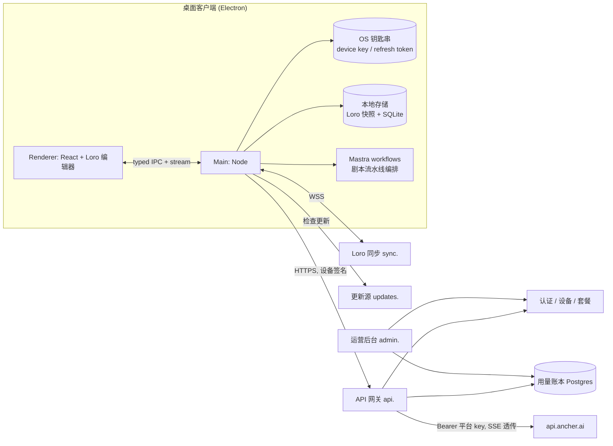
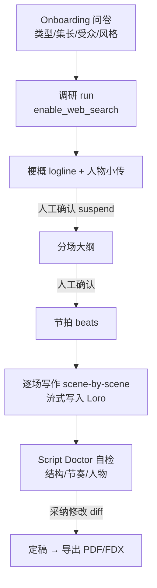
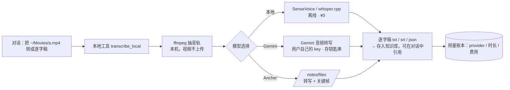
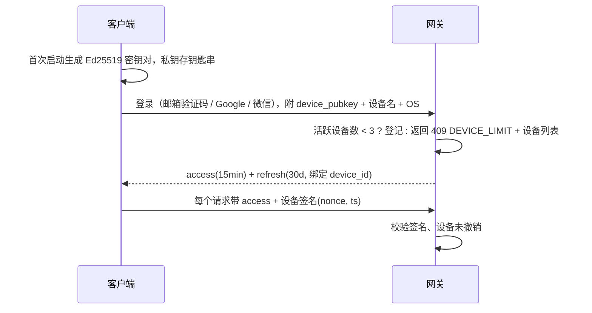

# 0002 · AIScript 桌面客户端（Windows + macOS）规格与上线路线图

> 状态：草案 v0.1 · 2026-10-08 · 作者：Claude Code（基于 [0001](./0001-aiscript-spec.md) 的原始需求）
> 读法：§1–§3 是结论与决策；§4–§9 是设计；§10 是"对照陈天 SDD 还差什么"；§11–§13 是测试、上线与待决项。
> 证据等级：**[实证]** 亲自核验（页面 / 源码 / 包内文件）；**[推断]** 有线索但未直接证实；**[待验证]** 需要账号、对方确认或实测。

---

## 1. 一句话与范围

**一句话**：一个以 Ancher API 为 AI 引擎的 AI 编剧桌面客户端（Windows + macOS），交互参考 laper.ai；一个账号最多绑定 3 台电脑，后台能看到每个账号的用量。

**复刻边界**：
- 可以参考：laper.ai 的**交互流程与信息架构**，例如"一份可编辑剧本为中心 + 结构视图 + 限定范围的 AI 读写"。
- 必须自有：品牌、文案、插画、图标、示例剧本。laper.ai 首页的 *Pulp Fiction* 示例本身就涉及第三方版权，绝不能复用。
- 原型和产品都用自有品牌，暂名 **AIScript**。

### 1.1 首个客户与真实痛点（2026-09-17 访谈）

来源：客户需求与痛点分析、访谈逐字稿、会议记录、工程讨论（都在 iCloud wiki `ai-script-agent/docs/`，这里只摘结论，不复制客户资料）。

- **客户**：少儿动画团队，项目规划 520 集，每集约 10 分钟，受众 5–10 岁，风格是"温暖现实主义 + 奇幻都市家庭喜剧"。核心编剧 2–3 人，另有 10+ 内部编剧、约 20 位外地编剧，**总导演是唯一的审核关口**。
- **生产链**：选题（批量 20–100 个，人工挑出约 5 个）→ 故事（约 500 字，起承转合完整）→ 故事大纲（约 1000 字）→ 分场（约 15 场、2000 多字）→ 剧本（约 5000 字）→ 导演审 → 改。已有一份第 1 集剧本，被指定为**格式范本**。
- **他们要的不是"更快出全稿"，而是"合格稿件的产量和通过率"。**

| 痛点（原话 / 现象） | 严重度 | 产品对策 | 原型页 |
|---|---|---|---|
| "点可以，做到故事就不行了"：创意点到故事这一步大量被否 | 高 | **故事工坊**：一个选题出 3 个冲突来源和解决方式都不同的走向，选定后**锁定故事核心** | P4 |
| "这个我们觉得不好笑"：AI 的笑点老套（踩香蕉皮） | 高 | **笑点方案**：选中一句台词，出 3–5 个方案，每个标注笑点机制；用户标"好笑 / 不好笑"后记进正反例；与规则冲突的方案直接标红 | P6 |
| "你看一个和看十个没区别"：同质化 | 高 | 候选走向强制差异化（冲突来源、解决方式、主笑点都不同），并显示差异度 | P4 |
| "出的全是传统文化"：理解偏题 | 中 | **项目圣经**：区分硬规则和偏好；淘汰的选题连同原因进入反例库 | P2 / P3 |
| 扩写时"写飘了"，大纲能生成到 10000 多字 | 中 | **锁定核心**（故事核心、重场戏、人物动机）随着每一步往下游传；**字数 / 场数 / 时长护栏** | P4 / P6 |
| 导演意见无法沉淀，"编剧 A 被否的，编剧 B 不知道" | 高 | **审稿与规则库**：导演批注、截图、录音 → AI 整理成待确认规则（带适用范围、来源、时间）→ 确认后全团队生效；冲突高亮；显示每条规则命中次数 | P7 |
| 想参考经典作品（如某日式家庭奇幻动画）的结构，换成自己的人物 | 中 | **结构复刻**：解析参考视频、链接或剧本 → 模型卡（节拍 + 笑点机制）→ 功能位映射到自家角色 → 原创度检查（只借结构，人物 / 道具 / 台词必须原创）；也能诊断已有剧本、按新结构重写 | P5 |
| 共用账号有封号风险，境外支付、API key 找不到 | 中 | 团队账号统一走我们的网关，**不需要 API key 和境外账号**；每人最多 3 台设备 | P1 / P10 |
| 担心资料和历史丢失 | 中 | 每一次审稿和 AI 修改都保留版本；本地副本加团队空间双份保存；整季可以打包导出（含规则库） | P9 |
| "没有大规模联网搜索的能力"；热点要按天整理 | 中 | 每日热点（已按儿童 / 家庭 / 学校 / 北京筛过）一键转成创意点；联网调研带引用 | P3 / P8 |

**不承诺的事项**（来自客户分析第七节）：不承诺"达到大师水平"，不承诺"90 分稳定输出"，不把会上讨论的费用数字当成预算，不预设"微调 / RAG"技术路线。方案文档里"抓取 8 个平台""用全网评论给幽默建模"这两条，需要逐个核实合规性（平台条款）和效果，**本版只把联网搜索和热点做成 Ancher 的 trending + web_search**。

**本轮（v1.0 上线）要做**（按客户优先级重排）：
1. **P0 创作链**：项目圣经 → 选题池 → 故事工坊（多走向 + 锁定核心）→ 大纲 / 分场 / 剧本（护栏 + 规则检查）
2. **P0 导演闭环**：审稿批注 → 规则库（人工确认入库，全团队生效）→ 正反例库
3. **P1 结构复刻**：参考作品解析 → 模型卡 → 角色映射 → 原创度检查；已有剧本诊断
4. **P1 Agent 能力**：联网调研、视频 / 链接 / 文件解析、风格反推、逆向提示词
5. **P0 账号**：团队空间 + 成员角色（总导演 / 核心编剧 / 外地编剧）+ 每人 ≤3 台设备 + 按人用量统计
6. 版本历史、按范本格式导出（DOCX / PDF / FDX）、本地优先 + 团队同步
7. 运营后台：团队、成员、设备、用量账本、额度

**本轮不做**：多人同时编辑同一场（v1 只做"同一集同一时间只有一个编辑者 + 版本"）、公开社区、AI 分镜 / 视频生成、移动端、Linux。

---

## 2. 关键结论（直接回答 0001 里的问题）

| # | 问题 | 结论 |
|---|---|---|
| Q1 | laper.ai 用了什么技术？ | **[实证]** Vite + React SPA，构建时预渲染；部署在 Cloudflare（R2、Images、Insights）；页脚写着 "100% Built by Claude Code · Powered by Loro CRDT / Mastra"；结构化数据里写着 "Loro CRDT project synchronization through a dedicated sync service"，`operatingSystem: Web, macOS, Windows`，版本 0.4.1。**[推断]** HTML 注释写着壳是 "Laper Web/Electron 共享"，说明桌面端是 Electron，与 Web 共用一套代码。 |
| Q2 | Ancher 三个包有什么区别，选哪个？ | **选 `@ancher-ai/sdk`。** 三个包都打到同一个后端 `api.ancher.ai`。`cli` 是给人和 CI 用的终端外壳，内嵌的是旧版 SDK 0.1.0；`agent-skills` 只负责给 Claude Code / Cursor 配置托管 MCP 和 SKILL.md，本身没有 API。只有 `sdk`（0.4.0）类型完整、跟随最新 OpenAPI，并内置 SSE 流式、上传和 OAuth2。详见 §5。 |
| Q3 | 能否 1:1 还原 ancher.ai 的 agent 能力？ | **大部分可以，有 3 个缺口。** 联网搜索、解析、逆向提示词都有接口。缺口：① 联网搜索**不能单独调用**，只能在对话 run 里开 `enable_web_search`；② Pro 审阅 agent、agent skills 由账号级 feature flag 控制，API 无法指定；③ "剧本生成""原型复刻"**没有专用接口**，只能当普通 agent 写作任务处理。详见 §5.3。 |
| Q4 | 一个账号只能绑 3 台电脑？ | **可以，但必须有自己的后端。** 每台设备生成密钥对（私钥存系统钥匙串），服务端登记设备并限制同时激活 ≤3 台，第 4 台需要先解绑。详见 §6。 |
| Q5 | 后台能追踪每个账号的 token 用量吗？ | **可以追踪，但要分两层，且需要我们自建网关。** **[实证]** Ancher 的响应和 SSE 事件里**没有 token usage 字段**，只有积分余额接口（`/me/billing/credits`，1 credit ≈ $0.001）。做法：所有 Ancher 调用都经过我们的网关，按 run 记账，记三样东西：① 我们自己用分词器估算的输入 / 输出 token；② 同一个上游 key 串行时前后积分余额之差（官方计量）；③ 时长与状态。同时**向 Ancher 申请在 `done` 事件里加 usage 字段**，有了之后切换为官方口径。详见 §7。 |
| Q6 | 客户端还需要服务器和域名吗？ | **需要。** 用途包括：账号与设备绑定、托管 Ancher 密钥（不能打进客户端）、用量账本、多设备同步（Loro）、自动更新源、运营后台、官网 / 下载页。最少需要一个主域名，加上 `api.` / `sync.` / `updates.` / `admin.` 子域名和 TLS。详见 §8。 |
| Q7 | 参考 llm-space？ | **[实证]** 它用的是 Electrobun（Bun 主进程 + 系统 WebView / 可选 CEF），**只发布 macOS**；登录只是 GitHub Device Flow，用于 gist 分享；token 明文存在 `~/.llm-space/settings/auth.json`（0600），没有用钥匙串；没有自家后端，也没有设备限制。**可以借鉴**：monorepo 分层（core / runtime / ui）、流式 RPC 设计、签名 + 公证 + 增量更新的 CI、AGENTS.md 和 PR 计划模板。**不建议照搬**：桌面框架（Windows 不成熟）和凭据明文存储。详见 §4.2。 |
| Q8 | 产品走查用什么 Skill？ | 推荐 **garrytan/gstack**（135.7k⭐，MIT）里的 `/design-review` 和 `/qa-only`，它自带浏览器，可以完成"走查 → 报告 → 修复"的闭环。中文走查方法论可补充 **denysosadchyi/ux-auditor**（25⭐，引入前先审一遍 SKILL.md）。详见 §12.3。 |

---

## 3. 需要你拍板的决策（带默认方案）

| ID | 决策 | 默认方案（不回复就按这个推进） | 影响 |
|---|---|---|---|
| D1 | 桌面框架 | **Electron + Vite + React**：Windows 支持最成熟，Mastra / Ancher SDK 可以直接跑在 Node 主进程，laper 也大概率是这个方案 | 体积约 100MB+ |
| D2 | Ancher 计费主体 | **平台托管一把（或几把）Ancher key，统一放在服务端网关**；终端用户用我们的账号登录，不碰 Ancher | 决定能否统一计量，以及能否做 3 设备限制 |
| D3 | 后端栈 | **TypeScript：Hono + Postgres + Drizzle**，Loro 同步服务走 Cloudflare Durable Objects 或自建 WS | 与前端同语言，便于 Claude Code 全栈开发 |
| D4 | 托管 | API 放在 **Zeabur 或 Fly（Postgres）**，静态站和更新源放在 **Cloudflare R2 / Pages** | 成本与国内访问 |
| D5 | 域名 | 待购，例如 `aiscript.app` | 阻塞签名、OAuth 回调、更新源 |
| D6 | 代码签名 | macOS 用 **Apple Developer ID**（$99/年）+ 公证；Windows 用 **Azure Trusted Signing**（约 $10/月）或 EV 证书 | 不签名的话 Windows SmartScreen / macOS Gatekeeper 会拦截 |
| D7 | 原型最终方向 | 从 v2 的 5 个 ancher token 方向（01 Ink Navy / 02 Ember Night / 03 Signal / 04 Garden / 05 Dusk Glass）里选一个；交互以 laper 为准 | 决定 design-tokens.css |
| D11 | 模型路由 | 对话输入框上提供模型选择；转写默认用本地 SenseVoice，可切换到 Gemini（自带 key）或 Ancher | 成本，见 §5.5 |
| D8 | 账号模型 | **团队空间（按席位计费）+ 成员角色**；"3 台设备"限的是每个成员，不是整个团队 | 客户有 30+ 编剧，单账号模型不成立 |
| D9 | AI 写入方式 | **剧本正文：先提案后写入（B）；大纲 / 分场：直接写入、按轮撤销（A）** | 导演审核文化要求"改动可见、可拒绝" |
| D10 | 原型托管 | 私有库在当前 GitHub 套餐下**不能开 Pages**（已实测 422）。可选：仓库改公开 / 升级 GitHub Pro / Cloudflare Pages / claude.ai 私有 Artifact | 本 PR 的"部署"步骤 |

---

## 4. 技术架构

### 4.1 总体



- **Ancher 密钥永远不进客户端。** 客户端只持有我们签发的短期 access token 和设备私钥。
- **Mastra 放在 Electron 主进程**，负责编排"一集剧本"流水线（§5.4）。每一步通过网关调用 Ancher。Ancher 的工具都在它的服务端执行，客户端不能注入自定义工具，所以 Mastra 的作用是**多步编排、挂起 / 恢复、人工确认**，不是替代模型。
- **Loro** 是剧本文档的唯一数据源：正文用 MovableList / 富文本，场景、角色树用 Tree。AI 的改动作为一次 CRDT commit 写入，因此天然支持撤销和 diff。

### 4.2 桌面框架对比

| 维度 | Electron（推荐） | Electrobun（llm-space 用的） | Tauri 2 |
|---|---|---|---|
| Windows 支持 | 成熟 | llm-space 没有发布 Windows，生态早期 | 成熟（WebView2） |
| 跑 Node 版 Ancher SDK / Mastra | 原生支持 | Bun 兼容大部分 | 需要 sidecar |
| 钥匙串 | `safeStorage`（DPAPI / Keychain） | 需自己实现 | keyring 插件 |
| 自动更新 | electron-updater（GitHub / R2，增量） | 内置 Updater（.patch 增量） | updater 插件 |
| 体积 | 约 100MB | 约 15MB（系统 WebView） | 约 10MB |
| 与 laper 的一致性 | **[推断]** 同为 Electron | — | — |

### 4.3 目录结构（S07 骨架）

```
aiscript/
  apps/desktop/      Electron：main/ preload/ renderer/
  apps/server/       Hono API 网关 + 认证 + 设备 + 账本
  apps/sync/         Loro 同步服务（DO 或 WS）
  apps/admin/        运营后台（React）
  apps/site/         官网 + 下载页 + 原型托管
  packages/core/     剧本领域模型（Loro schema、元素类型、导出）
  packages/agent/    Mastra workflows + Ancher 网关客户端
  packages/ui/       设计 tokens + 组件
  prototypes/        原型（单文件 + 层级切换器）
  specs/             0001… 规格
```

---

## 5. Ancher 接入方案

### 5.1 三个包对比 **[实证：npm tarball 包内文件，2026-10-08]**

| | `@ancher-ai/sdk` | `@ancher-ai/agent-skills` | `@ancher-ai/cli` |
|---|---|---|---|
| 版本 | 0.4.0（2026-09-24） | 0.1.1（2026-08-04） | 0.1.1（2026-08-04） |
| 形态 | TS 库（ESM + CJS），由 OpenAPI 生成；分两层 `createAncherClient` 和 `createAncherSdk` | 安装器 + 4 个 SKILL.md，配置托管 MCP `api.ancher.ai/mcp` | 命令行 `ancher`，输出 JSON，要求 Node 24 |
| 面向 | **应用开发者（我们）** | 编码 agent（Claude Code / Codex / Cursor） | 人 / CI 脚本 |
| 流式 | SSE → `ChatEvent`（text / thinking / tool-call / tool-return / citations / clarification / done / error），支持 `after` 断点续传 | 由 MCP 客户端负责 | `ancher chat` 流式输出 |
| 鉴权 | Bearer：API Key 或 OAuth2 + PKCE（`./oauth2`，带 TokenManager 自动刷新） | 走 MCP 的 OAuth | OAuth（client_id `ancher-cli`），凭据存在 `~/.config/ancher/credentials.json` |
| 桌面端适配 | ✅ 可直接在 Node 主进程或网关里使用 | ❌ 不是运行时 API | ⚠️ 只能通过子进程调用，SDK 版本落后 3 个小版本 |

**结论**：服务端网关和客户端都用 `@ancher-ai/sdk`。`agent-skills` 只用于**开发阶段**，让 Claude Code 能直接查询 Ancher 做调研，不进产品。

### 5.2 能力映射表

| ancher.ai 能力 | SDK / API | 产品里的入口 |
|---|---|---|
| Agent 对话 | `POST /api/v1/conversations` → 202 + `run_id` / `stream_url`；`GET …/stream` SSE；`POST …/interruption` 中断 | AI 面板、流水线每一步 |
| 联网搜索 | 对话请求体 `enable_web_search: true` → `citations` 事件（url / title / snippet / searchQueries） | "调研"按钮：题材、年代、行业细节 |
| 解析 | `POST /notes/url`、`/notes/text`、`/notes/files`（pdf / doc / ppt / 音视频）；对话附件 `WebPageAttachment` | 知识库：导入参考资料、小说原著 |
| 逆向提示词 | `POST /api/v1/image-prompts/`（multipart `image`）→ `prompt_en` / `prompt_local` | 角色 / 场景参考图 → 视觉提示词 |
| 检索（RAG） | `/retrievals`、`/retrievals/chunks` | AI 回答时引用知识库 |
| 选中文本解释 / 总结 / 翻译 | 对应接口 | 编辑器右键菜单 |
| 文件上传 | `File.upload`（预签名）、`uploadDirect`（带进度） | 附件 |
| 记忆 | `/users/me/memories/{file}` | 项目长期设定（世界观） |

### 5.3 1:1 对齐的风险与验证（必须在 Phase 1 实测）

1. **联网搜索不能单独调用**：要做独立的"搜索"界面，只能发一个专门的对话 run，再从 `citations` 里取结果。
2. **feature flag**：`use_review_agent`、`enable_agent_skills` 是账号级开关，平台 key 所属的账号要请 Ancher 开通。
3. **第三方 OAuth client**：如果将来要让用户用自己的 Ancher 账号登录，需要 Ancher 发一个 client_id（目前 spec 里没有注册第三方 client 的接口）。
4. **剧本生成和原型复刻没有专用接口**：通过 Mastra 流水线 + 系统提示词实现，质量要靠 §12.2 的评测集保证。
5. **配额**：`ConversationFeatureFlag` 显示 tokens_per_message 8000 / tokens_per_day 500000 / daily_messages 100。**平台单 key 会很快打满**，需要和 Ancher 谈企业配额或多 key 池。

### 5.4 "一集剧本"流水线（Mastra workflow）



每一步都是一个独立的 Ancher run，使用同一个 conversation 来复用上下文。挂起点由 Mastra 的 `suspend/resume` 实现，用户关掉应用后下次打开可以继续。

**剧本读写工具必须在本地执行**（走查实证：laper 的 agent 有约 15 个读写剧本的工具，见走查文档 §3）。Ancher 的工具都在它的服务端执行，碰不到我们本地的 Loro 文档，所以采用 **"Ancher 出结构化指令，本地执行"** 的方式：
1. 系统提示词约定输出格式：每一轮输出 `<ops>[{op:"insertNode", after, type:"dialogue", text}, …]</ops>` 加一段自然语言旁白
2. Mastra 解析 ops，校验 schema，在一个 Loro 事务里执行，UI 显示为工具卡片
3. 每一轮记录 `turnId → [commitIds]`，支撑 "Undo edit" 一键回滚
4. 读类工具（大纲、全文、角色）由本地在发请求前把上下文打包，作为 `WebPageAttachment` 或正文传给 Ancher，限制在 8k token / 消息以内

### 5.5 多模型路由与自带 key（BYOK）：以本地视频转逐字稿为例

**问题**：Ancher（Vita）API 很贵。能不能像 Codex 那样，由用户自己选模型，比如 Gemini？

**结论：可以。** 把"转写"做成**桌面端本地工具**，不交给 Ancher 的服务端 agent：



- **模型选择器**放在对话输入框上（和 Codex 一样），作用于后面的对话和工具调用；也可以给每个工具单独设默认值（例如"转写默认用本地"）
- **key 存放**：用户自带的 Gemini key 只存在本机钥匙串（Electron `safeStorage`），由主进程直连 Gemini，不经过我们的网关；团队统一的 key 则放在网关，计入账本
- **什么时候仍然需要 Ancher**：拆节拍、抽关键帧、结构复刻这类 Ancher 独有的多模态解析；联网搜索（`enable_web_search`）
- **账本**：每次调用都记 `provider`（ancher / gemini-byok / local），费用分开统计；用户自带 key 的调用只记次数和时长，不记费用
- **本机已有可复用的实现**：`video-asr` skill（SenseVoice，本地、多平台、带 SRT / JSON 输出），可以直接作为离线转写的参考实现

---

## 6. 账号与三设备绑定

**可行性：可以做到。** 流程：



**数据表**：`devices(id, user_id, pubkey, name, os, app_version, created_at, last_seen_at, revoked_at)`

**规则**：
- 同时活跃设备 ≤3（由套餐决定，可配置）
- 第 4 台登录时弹出"选择一台解绑"；每 30 天最多自助解绑 3 次，超出需要联系客服（防止账号共享）
- 解绑会立即撤销该设备的 refresh token；它下一次请求返回 401，客户端退回登录页，本地数据保留但设为只读
- 离线宽限期 7 天：离线时可以编辑本地剧本，AI 功能需要联网
- 后台可以查看和强制解绑设备，并能看到异常信号（同一账号多 IP 段高频切换）

**不能做到的**：完全防止用户克隆虚拟机。设备密钥存在钥匙串里，可以挡住拷贝配置文件这类简单共享，但挡不住有意的逆向。这是行业通行的取舍。

---

## 7. 用量账本（token 追踪）

**事实** **[实证]**：Ancher 的 SSE 事件和消息里都**没有 token 字段**，只有积分余额，以及 402 / `API-BIS002` 积分不足错误。

**方案**：所有 AI 调用都必须经过网关 `POST /v1/agent/runs`，由网关代理调用 Ancher 并透传 SSE。

`usage_ledger(id, user_id, device_id, project_id, run_id, upstream_run_id, feature, input_chars, output_chars, est_input_tokens, est_output_tokens, credits_before, credits_after, credits_delta, status, error_code, started_at, ended_at, idempotency_key)`

- **估算 token**：网关累加 SSE 文本，用 tokenizer 估算，实时得到，可用于限流
- **官方积分**：同一把上游 key 上的 run **串行化**（每把 key 一个队列），前后各读一次 `/me/billing/credits` 求差。并发场景用 **key 池**（每把 key 同一时刻只跑 1 个 run），否则差值无法归属到具体 run
- **中断 / 重试**：用 `idempotency_key` 去重；流中断时按已收到的部分记账，`status=partial`
- **对账**：每日任务把 Σcredits_delta 和 Ancher 账单比对，偏差超过 2% 告警
- **向 Ancher 提需求**：在 `done` 事件里返回 `usage{input_tokens, output_tokens, credits}`。拿到后去掉串行化

**后台视图**：按账号 / 天 / 功能统计用量，展示 Top N、额度消耗曲线，支持导出 CSV。

---

## 8. 服务器与域名

| 子域名 | 服务 | 必要性 |
|---|---|---|
| `aiscript.app` | 官网、下载页、隐私政策、服务条款 | 必须（签名、商店、支付都需要） |
| `api.` | 网关：认证、设备、套餐、Ancher 代理、账本 | **必须** |
| `sync.` | Loro 多设备同步（WSS） | v1 必须（多设备共用一个账号） |
| `updates.` | 自动更新清单 + 安装包（R2 / GitHub Releases） | 必须 |
| `admin.` | 运营后台（再加 Cloudflare Access 保护） | 必须 |
| `proto.` / GitHub Pages | 原型托管 | 当前阶段使用 |

**月成本粗估**（v1，1k MAU）：API + Postgres 约 $20–40，R2 / Pages 约 $0–5，Trusted Signing 约 $10，Apple 开发者约 $8（年费摊到每月），域名约 $1。**Ancher 积分是最大的变量成本**，需要按套餐定价覆盖。

**安全**：密钥只放在环境变量或密钥管理里；所有业务表都按 `user_id` 隔离；审计日志记录登录、设备变更和额度调整；支持用户导出数据和删除账号（GDPR / 个保法）。

---

## 9. 页面清单与原型

### 9.1 laper.ai 页面与状态 **[实证：公开页面]** + **[待验证：登录后]**

| # | 页面 | 已观察到的元素 | 关键状态 |
|---|---|---|---|
| P1 | 登录 / 注册 | Google、微信、邮箱 + 密码、Cloudflare Turnstile、忘记密码、注册切换（`?intent=signup`） | 默认 / 校验中 / 错误 / 未通过人机验证 |
| P2 | Onboarding | `/onboarding`（登录后） | **[待验证]** |
| P3 | 项目首页 / 列表 | **[待验证]** | 空态 / 列表 / 达到配额上限 |
| P4 | 剧本工作区 | 左侧导航：Writing / Characters / Locations / Props / Worldview / Knowledge / Advisors / Playground / Feature Request / Project settings；视图 Tab：Script / Outline / Beats / Storyboard / Scenes；场景列表（INT. / EXT. + 时间）；元素类型：Cover / Scene / Action / Character / Paren / Dialogue / Transition / Comment / Subtitle | 写作中 / 选中范围 / AI 修改 diff / 同步中 / 离线 |
| P5 | 右侧信息栏 | Info / Collaboration / Pagination（Paged）/ Format（Hollywood · Asian）/ AI Usage / Plan / Statistics（场景、字数、角色、地点、节拍、镜头、关系） | — |
| P6 | AI 助手面板 | 分步骤的进度（"Analyzing character bios → Locating character goals → Checking dialogue rhythm → Preparing revision notes"）+ 结论卡片 + 输入框 | 思考中 / 工具调用中 / 完成 / 失败重试 / 额度不足 |
| P7 | 角色 / 关系 / 选角 | 角色板、关系图（来自 featureList） | **[待验证]** |
| P8 | 定价 / 升级 | 5 档：Junior $0（10 次对话 / 月）· Senior $20 · Elite $60 · Master $100 · Legend $400；"AI chats"和"generation credits"分开计 | 当前套餐 / 升级 |
| P9 | 导出 | PDF、Final Draft XML | **[待验证]** |

> **[实证] 登录后走查已完成**：详见 [`docs/research/laper-walkthrough.md`](../docs/research/laper-walkthrough.md)（15 个状态、17 张截图、Agent 工具集、5 个问题）。要点：
> - Onboarding 只有**一句话 + 类型（剧本 / 快速视频）**，提交后自动建项目，AI 自动开跑
> - AI 依次执行：写大纲 → 建角色和地点 → 逐个插入剧本节点。过程中**自动切换视图**、**高亮正在写的节点**，结束时**用一个问题把方向交还给编剧**
> - 每一轮 AI 改动是一个事务：**"N edits this turn · Undo edit"**
> - 新手清单 6 步和 toast 联动；导出分三栏（集 × 内容 × 格式）
> - 页面集合按观察修正为：P1 登录 · P2 Onboarding · P3 首页 Recents · P4 剧本工作区（Script / Outline）· P5 AI 面板各状态 · P6 角色画布 · P7 制作设置与分镜 · P8 导出 · P9 定价升级

### 9.2 原型 v2（当前版本）

用户 2026-10-08 的反馈：**交互先按 laper 一比一做**；很多操作可以交给对话窗口里的 agent，不必单独做页面；**视觉只取 ancher.ai 仓库的 design token**，发散出 5 个方向。

- `prototypes/dist/index.html`：**8 页 × 5 个 token 方向 = 40 层**，单文件，离线可用
- 页面按 laper 走查还原：登录（+ 我们的设备上限）/ 一句话 Onboarding / 创作首页 / **工作区（AI 自动开写：读取 → 改名 → 写大纲 → 建角色和地点 → 插入节点高亮 → 新手任务 toast → 收尾提问 → 第二轮"N 处修改 · 撤销"）** / 角色画布 / 制作设置与分镜 / 最近 / 设备与用量（新增）
- token 来源：`streamify-one/ancher-website/src/styles/tokens/*`（n2 中性色 12 阶、b1–b5 品牌色、Manrope / Instrument Serif / Geist Mono、`--corner-radius` 10px × 倍率、阴影阶梯）。5 个方向的 DOM 完全相同，`check.mjs` 会机检"方向之间只有 token 不同"
- **客户痛点 → 对话快捷指令**（放在 laper 的「润色格式 / 总结大纲」旁边，`⌥1–⌥8`）：出 3 个不同走向 · 参考经典结构重写 · 笑点方案 · 检查是否写飘 · 记下导演意见 · 控字数 5000 字 / 10 分钟 · 转写本地视频 · 今日热点选题
- 输入框里有**模型选择**：Ancher / Gemini（自带 key）/ 本地 SenseVoice（见 §5.5）

### 9.2.1 原型 v1（存档：`prototypes/v1/`，按客户痛点做的 10 个独立页面 × 2 个方向）

`prototypes/dist/index.html`：**一个文件，20 层**（10 页 × 2 个方向），离线可以直接打开。源码在 `prototypes/src/`，用 `node prototypes/build.mjs` 构建。

| # | 页面 | 关键交互（可以点） | 对应痛点 |
|---|---|---|---|
| P1 | 登录与设备上限 | "演示：在第 4 台电脑上登录" → 选一台解绑 | 账号稳定 |
| P2 | 项目圣经 | 三步：体裁 → 解析资料（动画）→ 确认规则（硬规则 / 偏好可切换） | 偏题 |
| P3 | 选题池 · 每日热点 | 选中 / 淘汰（填原因 → 记为反例）；批量生成；热点转成创意点 | 选题质量 |
| P4 | 故事工坊 | 3 个走向 × 结构 / 笑点机制 / 字数护栏；选这个 / 换一个；锁定核心 | 点到故事、同质化 |
| P5 | 结构复刻 | 解析参考视频 → 模型卡 → 功能位映射 → 原创度 → 套用；诊断已有第 1 集 | 换成自己的人物 |
| P6 | 剧本工作区 | AI 写第 3 场（A 直接写入 + 撤销 / B 提案 + 接受或拒绝）；笑点方案；护栏；规则检查 | 写飘、不好笑 |
| P7 | 审稿与规则库 | 导演否决批注 → 待确认规则 → 确认入库 / 驳回；冲突高亮；命中次数 | 反馈沉淀 |
| P8 | 资料台 | 联网调研 / 视频解析 / 风格反推 / 逆向提示词 | 联网与解析 |
| P9 | 版本与导出 | 版本链（否决 / 通过）；升格为范例；按范本格式导出；B 是左右对比 diff | 资料不丢 |
| P10 | 团队、设备与用量 | 成员角色、每人设备 x/3、按人统计 tokens 和费用 | 共用账号、成本 |

### 9.3 原型规范（"单文件 + 悬浮层级切换器 + 每层一个完整 HTML 文档"）

- 入口是 `prototypes/dist/index.html`，**单文件**，内联 CSS / JS，不依赖任何外部资源，离线可以打开
- 每个"层"是一份完整的 HTML 文档（`<!doctype html>…</html>`），以 JSON 字符串的形式嵌入，`</` 已转义，防止提前截断 script；切换时注入 `iframe.srcdoc`，各层样式互相隔离
- 悬浮切换器在右上角，可以收起成标题栏上的一个小胶囊。三组选择：**页面**（P1…P10）× **方向**（A / B）× **系统**（macOS / Windows 窗口外框）。快捷键：`↑/↓` 页面，`A/B` 方向，`M/W` 系统，`H` 收起；URL hash 记住位置（如 `#p6-b-win`）。键盘切换没有动画（Emil：高频操作不加动画）
- 两个方向：
  - **A · Studio Paper（纸感专业）**：暖白纸面、衬线标题、Courier Prime 剧本正文，克制低饱和，接近传统编剧软件，AI 退到侧栏
  - **B · Night Desk（暗色沉浸）**：深色、聚焦模式，AI 作为浮动指令条（⌘K）贴近光标，结构视图用卡片墙
- 动效遵循 emil-design-eng：UI 动画 <300ms，ease-out，按压 scale(0.97)，只对 transform / opacity 做动画，遵守 `prefers-reduced-motion`

---

## 10. 对照陈天 SDD：现状、缺口与下一步提示词

| 步骤 | 原提示词 | 现状 | 缺口 / 下一步交付物 |
|---|---|---|---|
| S00 约束 | P-W2-01 / P-W7-05 | 0001 只有需求原文 | 写 `CLAUDE.md` constitution：TS 全栈严格类型；JSON 用 camelCase；**必须鉴权 + 按 user_id 隔离**；密钥只走环境变量；依赖用最新版（bun / pnpm 二选一） |
| S01 范围 | P-W1-01 / P-W2-02 | 本文 §1 | ✅ 已有本轮范围；需要你确认"本轮不做"的清单 |
| S02 调研 | P-W3-04 / P-W7-04 / P-W4-06 | 本文 §2、§4、§5（包内实证） | **Ancher 最小接入实测**：用真实 key 跑通 对话 / 搜索 / 解析 / 逆向提示词 4 个脚本，结果写到 `specs/research-ancher.md`；Loro 同步服务端选型确认许可证（Rust server 疑似 AGPL） |
| S03 PRD | P-W7-01 / P-W7-02 / P-W5-02 | 未开始 | `0003-prd.md`：完整写出 P1–P9 每个操作的触发、成功、失败、持久化；补齐 SaaS 必备项（注册、找回密码、套餐与付费墙、用量限制、导出 / 删除账号、设备管理）；用 codex 交叉评审 |
| S04 设计 | P-W7-03 / P-W5-03 | 本文 §4–§8 是骨架 | `0004-design-spec.md`：完整 API 合同（OpenAPI）、数据模型、IPC 合同、Loro schema；mermaid 图 |
| S05 Agent | P-W6-02 | 本文 §5.4 | 为流水线每一步写系统提示词 `packages/agent/prompts/*.md`；只提 Ancher 实际具备的能力 |
| S06 计划 + 评审 | P-W5-04 / P-W5-05 / P-W5-07 | 未开始 | `0005-design-review` / `0006-impl-plan` / `0007-impl-plan-review` / `0008-test-plan` / `0009-test-plan-review` |
| S07 骨架 + 风格 | P-W7-06 / P-W1-06 | 原型进行中 | 选定原型方向后输出 `design-tokens.css` 和分层 `CLAUDE.md`（main / renderer / server） |
| S08 实现 | P-W5-06 / P-W7-07 | — | 分阶段实现，见 §11 |
| S09 测试 | P-W1-04 / P-W2-03 / P-W5-08 / P-W5-09 / P-W6-04 | — | 见 §12 |
| S10 审查回写 | P-W6-05 / P-W3-13 | — | 每个 phase 结束跑一次 codex review → `00xx-code-review.md` |
| S11 交付 | P-W7-17 / P-W5-10 | — | **课程原本没有部署提示词**，单独写 `00xx-deploy.md`（见 §13） |

---

## 11. 实现阶段（每个 phase 都要有可运行的证据）

| Phase | 内容 | 验收 |
|---|---|---|
| 0 | 原型两个方向 + 选型确认 + 仓库 / CI | 原型上线，CI 绿 |
| 1 | Ancher 接入实测（4 条脚本）+ 网关 PoC（SSE 透传 + 账本写入） | 4 种能力都返回结果；账本有记录 |
| 2 | Electron 骨架、登录、钥匙串、设备绑定 | 第 4 台设备登录被拒；解绑后可以登录 |
| 3 | Loro 剧本编辑器（9 种元素、自动格式、分页）+ 本地持久化 | 重启后不丢数据；输入 1 万字不卡顿 |
| 4 | Mastra 流水线：onboarding → 一集剧本 | 评测集 10 个题目里 ≥8 个产出完整的一集 |
| 5 | AI 面板（限定范围的读写、diff 采纳）、知识库、逆向提示词 | E2E 通过 |
| 6 | 同步、导出 PDF / FDX、运营后台 | 两台设备的编辑最终一致；FDX 能被 Final Draft 打开 |
| 7 | 签名、公证、自动更新、beta 发布 | Win / mac 实机安装、升级、卸载都通过 |

---

## 12. 测试

### 12.1 陈天 SDD 中与 Test 相关的提示词（逐字摘抄）

完整原文（37 段，含章节和行号）：[`docs/research/sdd-test-prompts-raw.md`](../docs/research/sdd-test-prompts-raw.md)。按类别列出核心条目：

**A. 测试计划（S06）**

> P-W5-07 · pg-mcp test plan（prompts.md:1931）
> ```
> 根据 ./specs/w5/0004-pg-mcp-impl-plan.md 和 ./specs/w5/0002-pg-mcp-design.md 文档，构建 pg-mcp 的测试计划，think ultra hard，文档放在 ./specs/w5/0007-pg-mcp-test-plan.md 文件中。之后调用 codex review skill 让 codex review ./specs/w5/0007-pg-mcp-test-plan.md 文件，并构建 ./specs/w5/0008-pg-mcp-test-plan-review.md 文件。
> ```

**B. 测试数据 / Fixture**

> P-W1-04 · seed sql（prompts.md:829）
> ```
> 添加一个 seed.sql 里面放 50个 meaningful 的 ticket 和几十个tags（包含platform tag，如 ios，project tag 如 viking，功能性 tag 如 autocomplete，等等）。要求 seed 文件正确可以通过 psql 执行。
> ```
> P-W5-08 · pg-cmp 测试数据库（prompts.md:1950）
> ```
> 根据 @specs/w5/0001-pg-mcp-prd.md 在 ./w5/pg-mcp/fixtures 下构建三个有意义的数据库，分别有少量，中等量级，以及大量的 table/view/types/index 等schema，且有足够多的数据。生成这三个数据库的 sql 文件，并构建 Makefile 来重建这些测试数据库。
>
> commit 然后你来建立和测试这几个数据库确保可用
> ```

**C. Agent 测试（看用例能否生成）**

> P-W5-09 · 构建 pg-mcp 的测试用例（prompts.md:1971）
> ```
> 对于 @w5/pg-mcp，将这个 mcp 添加到 claude code 中，打开一个 claude code headless cli 选择 @w5/pg-mcp/fixtures/TEST_QUERIES.md 下面的某些 query，运行，查看是否调用这个 mcp，结果是否符合预期
> ```
> P-W5-10 · postgres 查询 skill（第 3–4 步是 Agent 自测闭环）（prompts.md:1992）
> ```
> 3. 使用 psql 测试这个 SQL 确保它能够执行并且返回有意义的结果。如果执行失败，则深度思考，重新生成 SQL，回到第 3 步。
> 4. 把用户的输入，生成的 SQL，以及返回的结果的一部分进行分析来确认结果是不是有意义，根据分析打个分数。10分非常 confident，0分非常不 confident。如果小于 7 分，则深度思考，重新生成 SQL，回到第 3 步。
> ```
> P-W6-01 · simple agent 构建（prompts.md:2017）
> ```
> …完成构建后，确保所有实现否符合 design spec，并提供几个 example 来展示如何使用（包含至少一个使用 mcp 的例子）。
> ```
> P-W6-04 · 构建 codereview agent 代码（prompts.md:2090）
> ```
> …代码要完整实现 design spec，符合其要求。实现完成后请根据几个场景运行测试，确保它正常工作。
> ```

**D. 网站 / 前后端联调（S09）**

> P-W2-03 · 测试（prompts.md:1011）
> ```
> 仔细阅读 ./w2/db_query 下面的代码，然后运行后端和前端，根据@w2/db_query/fixtures/test.rest 用 curl 测试后端已实现的路由；然后用 playwright 开前端进行测试，任何测试问题，think ultra hard and fix
> ```
> P-W2-04 · db migration & unit test（prompts.md:1030）
> ```
> `make setup` 会出错，修复它；确保前后端 unit test 都通过。
> ```
> P-W2-06 · 测试 MySQL db 支持（prompts.md:1068）
> ```
> 目前 mysql 已经得到支持，在 ./w2/db_query/fixtures/test.rest 中添加 MySQL db 支持的测试用例，然后运行测试。如果后端测试 ok，那么打开后端和前端，使用 playwright 测试前端，确保 MySQL db 的基本功能：
> ```
> P-SITES-05 · 截图验证规则（prompts.md:185）
> ```
> …完成后，使用 playwright 运行页面，截取快照，确保一切看起来正确（对于交互部分，执行操作后也要截取快照）。
> ```

**E. Bug 报告格式（以规格为准）**：P-W7-08（API 404 → 以 design spec 为准补齐）、P-W7-09（UI 不符合线框图 / tokens）、P-W7-14（刷新后丢失 → 持久化，make sure DRY）。

**F. 桌面端崩溃排查**：P-W3-06 至 P-W3-12（Tauri 应用 hotkey 闪退、录音、TLS 等，做法是贴完整日志和堆栈，让 Agent 定位）。

### 12.2 套用到 AIScript 的测试提示词（演绎版）

```
# ① 测试计划（S06）
根据 ./specs/0006-impl-plan.md 和 ./specs/0004-design-spec.md 文档，构建 aiscript 的测试计划，覆盖 单元 / 集成 / E2E(Playwright for Electron) / Agent 评测 / 设备并发 / 账本对账 / 安全，think ultra hard，文档放在 ./specs/0008-test-plan.md。之后调用 codex review skill review 并构建 ./specs/0009-test-plan-review.md。

# ② Fixture
在 ./fixtures 下构建三档有意义的剧本项目：短（1 场）、中（1 集 20 场）、长（10 集），以及 3 个账号（免费/付费/设备已满）。提供 make seed 重建。

# ③ Agent 测试（P-W5-09 + P-W5-10 套路，题目来自客户真实样本）
用 ./fixtures/AGENT_CASES.md 中客户提供的 10 个真实创意点，在 headless 模式下运行"选题→故事(3 走向)→大纲→分场→剧本"流水线，检查：
- 硬规则零违反（项目圣经 + 规则库逐条机检）；锁定核心在分场与剧本中保留（逐项比对）
- 字数护栏：故事 ≤ 550 字、分场 13–17 场、剧本 4500–5500 字
- 3 个走向的冲突来源/解决方式两两不同；与反例库相似度低于阈值
- 是否调用了 web_search（citations 非空）
对每个结果按 结构/人物/幽默/项目符合度 打分 0–10，小于 7 分则记录失败原因并回到对应步骤重试一次。
最终质量以【导演盲评通过率】为准（AI 稿与人工稿混排），机评只做回归门槛。

# ④ 联调
运行 server 与 desktop，根据 ./fixtures/api.rest 用 curl 测试网关所有路由；然后用 Playwright(_electron) 走 onboarding→生成一集→导出，每一步截图；任何问题 think ultra hard and fix。
```

### 12.3 产品走查

- 每个 phase 结束跑一次 gstack `/design-review`（设计）+ `/qa-only`（功能）。报告写到 `docs/qa/phase-N.md`，问题按严重度分级
- 用 emil-design-eng 的 Before / After / Why 表格审查动效和细节

### 12.4 必测清单（上线门槛）

- [ ] 未登录访问 API → 401；用 A 账号的 token 读 B 账号的项目 → 404
- [ ] 第 4 台设备登录 → 409；解绑后 → 成功；被撤销的设备下一次请求 → 401
- [ ] 流中断 / 重试 / 重复提交不会重复记账（idempotency）
- [ ] 安装包内搜不到任何 Ancher key（`strings` 扫描）
- [ ] 提示词注入：解析的网页里含"忽略之前指令"，不会越权调用工具
- [ ] 断网编辑 → 联网后同步一致；两端并发编辑同一场景最终一致
- [ ] Win 10/11、macOS 13+（Intel / Apple Silicon）实机：安装、首次启动、升级、卸载

---

## 13. 部署与发布

1. **环境**：`dev`（本地）→ `staging`（`*.staging.` 子域，独立 Postgres 和 Ancher 测试 key）→ `prod`
2. **CI（GitHub Actions）**：lint、typecheck、单测、build、`gitleaks` 密钥扫描；PR 必须全绿才能合并
3. **桌面发布**：打 tag → 矩阵构建（mac arm64/x64 + win x64）→ macOS 签名 + 公证，Windows 用 Trusted Signing 签名 → 上传到 `updates.` → 先发 beta 渠道，冒烟通过后再推 stable
4. **后端发布**：先跑迁移（只做可回滚的加列）→ 蓝绿部署或滚动发布 → 健康检查 → 失败自动回滚
5. **监控**：Sentry（客户端 + 服务端）、uptime、Ancher 错误率 / 402 率 / 积分余额告警、账本对账偏差告警
6. **备份**：Postgres 每日快照，保留 7 天并做异地备份；Loro 快照存 R2
7. **回滚**：桌面端更新清单回指上一个版本；服务端回滚到上一镜像

**当前阶段（本 PR）**：只部署原型到 GitHub Pages。

---

## 14. 阻塞项（需要外部输入）

| 项 | 谁 | 阻塞什么 |
|---|---|---|
| Ancher 平台 key + 企业配额 + feature flag 开通 + 是否会在 `done` 里加 usage | 你 ↔ Ancher | Phase 1、§7 |
| 域名 | 你 | 签名、OAuth 回调、更新源 |
| Apple Developer / Azure Trusted Signing 账号 | 你 | Phase 7 |
| 原型方向选择（D7）、原型托管方式（D10） | 你 | S07、本 PR 部署 |
| 客户样本："创意点 → 被否故事 → 导演意见 → 通过稿"3–5 组；好笑 / 不好笑片段各 3 个；现行大纲版本；各阶段合格样例 | 你 ↔ 客户 | Agent 评测集（§12.2）、规则库冷启动 |
| 团队规模与权限：实际需要账号的人数、外地编剧能看到什么、资料能否离开客户环境 | 你 ↔ 客户 | §6 账号模型、§8 数据驻留 |
