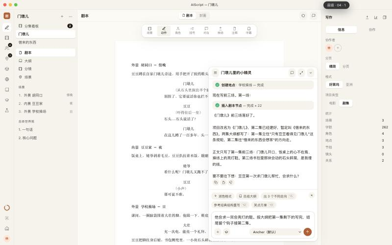

# AIScript 原型 v2

`dist/index.html` 是单个文件，共 40 层：**8 个页面 × 5 个 design token 方向**，每层都是一份完整的 HTML 文档。文件大约 1.2MB，有些预览器打不开，用浏览器直接打开即可，离线可用。

- **交互**：一比一按 laper.ai 的实际流程（见 [走查记录](../docs/research/laper-walkthrough.md)）。工作区一打开，AI 就自动根据那句故事开写：读取 → 改名 → 写大纲（自动切到大纲视图）→ 建角色和地点 → 逐个插入剧本节点（正在写的高亮）。新手任务 toast 联动，每轮结尾 AI 提一个问题，第二轮显示"N 处修改 · 撤销"
- **视觉**：只换 design token，用 Emil（emil-design-eng）的方法发散出 5 个方向。每个方向除了颜色、字体、圆角、阴影，还定义了**动效 token**：入场缓动、按压缩放、按钮反馈 / 弹层 / 模态时长、入场位移、spinner 速度、AI 落笔高亮时长。所有 UI 动效 ≤300ms，进出场用 ease-out，不从 scale(0) 起，越是高频使用的方向动效越少。5 个方向的 DOM 完全相同，`check.mjs` 机检
- token 来源：**app.ancher.ai** 线上 CSS 变量（n1/n2/n3 中性色、b1–b5 品牌色、Manrope / Lora / Geist Mono、radius 8、`--ease-fast`）；**ancher 仓库**桌面 Agent 的 `new-design/components/tokens.jsx`（暖纸 oklch、唯一锈红、鼠尾草绿、赭黄、Source Serif 4 / Geist / JetBrains Mono、暖棕阴影）

| # | 方向 | 色彩 / 字体 | 动效性格 |
|---|---|---|---|
| 01 | Studio Rust · 纸墨锈红 | 桌面 Agent 原生：暖纸 + 锈红，Source Serif + Geist | ease-out 强曲线，按压 0.97 / 160ms，弹层 200ms |
| 02 | App Navy · 产品藏蓝 | app.ancher.ai 浅色原样：n2 + b1，Lora + Manrope，radius 8 | 产品自带 `--ease-fast`，0.98 / 150ms |
| 03 | App Ember · 产品余烬 | app.ancher.ai 深色原样：n2 暗 + b2 橙 | 位移只有 4px，AI 落笔高亮 700ms 便于追踪 |
| 04 | Graphite Signal · 石墨信号 | n3 冷紫灰 + b3，圆角 ×0.5，Geist Mono 标签 | 为高频使用设计：100ms 按压，弹层只淡入不位移 |
| 05 | Lamplight · 台灯夜写 | 暖暗 + 赭黄 / 鼠尾草，Source Serif 斜体，毛玻璃 | 最柔：抽屉曲线 280ms，位移 10px，高亮 900ms |

快捷键：`↑/↓` 换页，`1–5` 换方向，`M/W` 切换 macOS / Windows 外框，`H` 收起切换器，`P` 换 picker 样式，`⌘K` 或 `/` 打开命令面板。

**层级切换器有 5 种样式**（按 Emil 的细节规则做；功能相同，只是交互不同）：

| # | 样式 | 细节 |
|---|---|---|
| 1 | Dock 形变 | 胶囊用 clip-path 展开成面板（展开 260ms / 收起 180ms，不对称）；当前页高亮条平移；系统切换用 clip-path 做颜色过渡；方向用"底色 + 主色"的半圆色板 |
| 2 | 命令面板 | 像 Raycast：⌘K 打开时没有动画，鼠标点击打开时从触发点缩放出来；搜索覆盖页面 × 方向的 40 个组合；方向键选择、回车应用 |
| 3 | 底部胶片条 | 8 张页面缩略卡，色块用当前方向的颜色；首次出现逐张错开 30ms；收起按自身高度下滑 |
| 4 | 可拖拽圆钮 | 拖拽时捕获指针、拖出边缘有阻尼；松手按速度甩向最近的角（速度 > 0.11 就算甩），用抽屉曲线吸附；外圈 5 段代表 5 个方向；菜单从圆钮所在的角展开 |
| 5 | 侧边刻度尺 | 贴右边缘的刻度；悬停提示第一次延迟、之后立即出现；滚轮翻页 |

通用规则：键盘切换没有任何动画；鼠标切换时新旧两层带 2px 模糊交叉淡入淡出（220ms）；所有按钮按下缩放到 0.97；遵守"减少动态效果"。

P4 工作区里还有三项我们新增的对话能力：
- **激活**（P1）：输入激活码 → 绑定本机 → 填写自己的 Ancher API key；**设置**（P8）：激活与授权、模型与密钥、项目数据（不显示用量）
- 输入框上方：润色格式 / 总结大纲 / 润色对白 / 续写场景 / 检查人物一致性 / **⚡ 工作流**（8 个痛点工作流，`⌥1–⌥8`；进度卡片可取消，失败可重试；改写类先出修改预览）
- 模型标识：只配置 Ancher 时是固定标签，添加 Gemini key 后变成下拉菜单



构建并校验：

```bash
node specs/images/prototypes/build.mjs && node specs/images/prototypes/check.mjs
```

v1（10 页 × 2 个方向，按客户痛点设计的独立页面）存档在 [`v1/`](v1/)。示例故事是原创内容。
